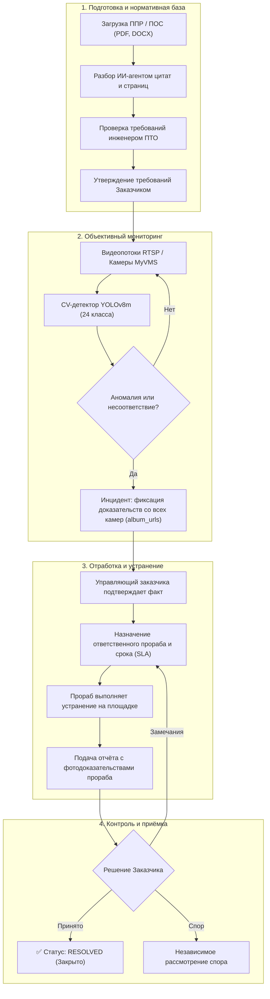

<div align="center">

# «Stroycontrol»

### Автоматизированный сервис интеллектуального поиска нарушений и контроля спецтехники на строительных площадках Москвы

[](https://leaders2026.innoagency.ru/)
[](https://www.mos.ru/dgp/)
[](#-команда-black-lotus)
[](#)

<br/>

[](https://www.python.org/)
[](https://fastapi.tiangolo.com/)
[](https://react.dev/)
[](https://www.typescriptlang.org/)
[](https://ultralytics.com/)
[](https://www.postgresql.org/)
[](https://redis.io/)
[](https://docs.celeryq.dev/)
[](https://www.docker.com/)

<br/>

<p align="center">
  <strong>Интеллектуальная система объективного видеомониторинга, автоматического выявления нарушений требований ППР/ПОС и сквозного контроля устранения замечаний подрядчиками на строительных объектах города Москвы в режиме реального времени.</strong>
</p>

<p align="center">
  
</p>

[ Возможности](#-ключевые-возможности) •
[ Бизнес-процесс](#️-сквозной-бизнес-процесс-и-статусы) •
[ Стек](#-технологический-стек) •
[ Быстрый старт](#-быстрый-старт-локальный-qa-стенд) •
[ Роли и аккаунты](#-ролевая-модель-и-тестовые-аккаунты) •
[ Docker](#-полный-стенд-в-docker) •
[ ИИ и CV](#-компьютерное-зрение-и-llm-агенты) •
[ Погода](#️-погода-и-метеопредупреждения) •
[ Документация](#-документация-и-структура) •
[ Команда](#-команда-black-lotus)

</div>

---

> [!IMPORTANT]
> **Сквозной регламент контроля качества строительных работ:**
> **ППР / ПОС** ➔ **проверенное требование** ➔ **утверждение заказчиком** ➔ **камера / RTSP / видео** ➔ **событие с фотодоказательствами со всех ракурсов** ➔ **назначение ответственного прораба** ➔ **устранение на площадке** ➔ **независимая приёмка заказчиком**.

---

## О проекте

**«Строй-контроль»** — комплексная платформа для Департамента градостроительной политики города Москвы, объединяющая передовые методы **компьютерного зрения (Computer Vision)**, **мультимодальных LLM-агентов** и **строгой ролевой модели управления стройкой**.

Система решает ключевые проблемы надзора за строительством:
- **Устранение человеческого фактора:** исключение субъективности при проверке строительных площадок благодаря постоянному видеоконтролю и объективной фиксации нарушений.
- **Связка с нормативной документацией:** автоматический разбор проектов производства работ (ППР) и организации строительства (ПОС) с привязкой спецтехники к календарному графику (46 этапов СМР).
- **Сквозной контроль ответственности:** прозрачный жизненный цикл инцидентов от детекции до проверки исправления с разделением зон ответственности генподрядчиков и субподрядчиков.
- **Мультикамерная доказательная база:** агрегация снимков со всех камер объекта в момент фиксации аномалии — отсутствие техники на одной камере перепроверяется по другим ракурсам для предотвращения слепых зон.

---

## Ключевые возможности

| Функция | Описание |
| :--- | :--- |
| ** Мультикамерный нейросетевой мониторинг** | Детекция 24+ категорий спецтехники и рабочих на базе обученной модели **YOLOv8m (960px)**. Пространственная мультикамерная агрегация устраняет слепые зоны, а окно темпоральной устойчивости (30 сек) отсекает кратковременные перекрытия. |
| ** Интеллектуальный разбор ППР и ПОС** | LLM-агенты (Ollama Qwen2.5:7b, GigaChat, OpenAI) автоматически извлекают требования к технике из PDF и DOCX, валидируют точные страницы и цитаты и сопоставляют их с утверждённым графиком СМР. |
| ** Доказательная база и фотоальбомы** | Каждое нарушение сохраняет структурированный фотоархив со всех оптических сенсоров объекта (`album_urls`). Никакие доказательства не могут быть удалены или сфальсифицированы. |
| ** Ролевой доступ и защита от конфликта интересов** | Чёткое разделение ролей: **Управляющий заказчика**, **Прораб подрядчика**, **Инженер ПТО**, **Наблюдатель**. Подрядчик не видит чужие зоны и не может подтвердить собственное устранение. |
| ** Алерты и автоконтроль устранения** | Настраиваемые SLA (2 ч для критических ошибок, 24 ч для предупреждений). Celery Beat автоматически запускает перепроверку камер по истечении таймера; в случае неустранения формируется эскалация руководству. |
| ** Геокодинг и метеорологический контроль** | Интеграция с Open-Meteo и Nominatim/OSM: автоматическое определение координат стройплощадки, 7-дневный прогноз и штормовые предупреждения (ветер > 54 км/ч, заморозки, ливни, снегопад). |
| ** Адаптивный рабочий интерфейс** | React 19 + TypeScript SPA: эргономичные дашборды для каждого специалиста, интерактивная работа с чертежами и видеопотоками, полная поддержка мобильных устройств на стройплощадке. |

---

## Сквозной бизнес-процесс и статусы

Сервис реализует строгий регламент взаимодействия между Заказчиком, Подрядчиками и Инженерами ПТО:



### Жизненный цикл инцидента

| Статус API | Значение и бизнес-логика |
| :--- | :--- |
| `pending` | Первичное обнаружение системой; требует подтверждения человеком |
| `confirmed` | Заказчик подтвердил нарушение, назначен ответственный подрядчик и срок устранения |
| `in_progress` | Задача находится в работе у прораба (в том числе после возврата с замечаниями) |
| `remediation_submitted` | Прораб направил доказательства устранения; дело ожидает инспекции Заказчика |
| `resolved` | Заказчик лично принял результат устранения замечания |
| `false_positive` | Обнаружение отклонено управляющим (ложная тревога / штатная ситуация) |

---

## Технологический стек

<div align="center">

| Уровень | Технологии |
| :--- | :--- |
| **Frontend** | **React 19**, **TypeScript 5**, **Vite 6**, CSS Modules, Fontsource Inter, Playwright |
| **Backend & API** | **Python 3.12**, **FastAPI**, **Pydantic v2**, **SQLAlchemy 2**, **Alembic**, **PyJWT** |
| **Computer Vision & AI** | **Ultralytics YOLOv8m** (24 активных класса спецтехники, 960px), **OpenRouter Vision VLM**, **LangChain**, **GigaChat**, **Ollama (Qwen 2.5:7b)** |
| **Базы данных и очереди** | **PostgreSQL 16** (UUIDv4, 3NF, JSONB), **Redis 7**, **Celery** (Worker + Beat) |
| **Внешние сервисы** | **Open-Meteo API** (погода), **Nominatim / OpenStreetMap** (геокодинг), **MyVMS** (видеопотоки) |
| **DevOps & Контейнеризация** | **Docker**, **Docker Compose**, **Caddy 2** (HTTPS reverse proxy), GitHub Actions |
| **Тестирование и QA** | **Pytest**, **Playwright Browser Tests**, **Ruff**, **ESLint**, **Mypy** |

</div>

---

## Быстрый старт: Локальный QA-стенд

Для мгновенной проверки функционала без развёртывания тяжёлых СУБД подготовлен изолированный стенд с синтетическими данными, документами ППР и тестовыми ролями.

### Требования
- Python **3.11+** или **3.12+**
- Node.js **20+** или **22+** и npm

### Запуск в 3 шага

```bash
# 1. Клонирование репозитория
git clone https://github.com/Black-Lotus-2026/LTC-stroy-control.git
cd LTC-stroy-control

# 2. Установка зависимостей
python -m venv backend/.venv
# Windows:
backend\.venv\Scripts\pip install -r backend/requirements.txt
# Linux/macOS:
# backend/.venv/bin/pip install -r backend/requirements.txt

npm ci
```

**Терминал 1 — Сервер API и тестовые данные:**
```bash
# Windows:
backend\.venv\Scripts\python tools/customer_control_demo.py --port 8991
# Linux/macOS:
# backend/.venv/bin/python tools/customer_control_demo.py --port 8991
```

**Терминал 2 — Пользовательский интерфейс:**
```bash
# Windows PowerShell:
$env:VITE_API_URL="http://127.0.0.1:8991"; npm run dev -- --host 127.0.0.1 --port 5193 --strictPort
# Linux/macOS:
# VITE_API_URL=http://127.0.0.1:8991 npm run dev -- --host 127.0.0.1 --port 5193 --strictPort
```

### Доступные адреса

| Сервис | URL | Назначение |
| :--- | :--- | :--- |
| **Рабочий интерфейс** | [http://127.0.0.1:5193](http://127.0.0.1:5193/) | Вход в систему и рабочие экраны ролей |
| **Swagger API Docs** | [http://127.0.0.1:8991/docs](http://127.0.0.1:8991/docs) | Интерактивная документация REST API |
| **Healthcheck** | [http://127.0.0.1:8991/api/v1/health](http://127.0.0.1:8991/api/v1/health) | Проверка работоспособности бэкенда |

---

## Ролевая модель и тестовые аккаунты

Для тестирования ролевого взаимодействия в локальном стенде предусмотрены готовые учётные записи:

| Логин | Пароль | Роль | Область ответственности и возможности |
| :--- | :--- | :--- | :--- |
| `qa_manager` | `LocalQa2026!` | **Управляющий заказчика** | Полный контроль объектов: утверждение требований ППР, валидация детекций, назначение подрядчиков и сроков, приёмка устранений. |
| `qa_manager2` | `LocalQa2026!` | **Второй управляющий** | Независимое рассмотрение спорных ситуаций и разногласий между сторонами. |
| `qa_foreman` | `LocalQa2026!` | **Прораб подрядчика №1** | Доступ только к задачам своей организации: взятие в работу, загрузка доказательств устранения, оспаривание замечаний. |
| `qa_foreman2` | `LocalQa2026!` | **Прораб подрядчика №2** | Доступ исключительно ко второй задаче; задачи первого подрядчика строго изолированы. |
| `qa_pto` | `LocalQa2026!` | **Инженер ПТО** | Загрузка ППР/ПОС, проверка страниц, цитат и нормативных привязок, передача требований на утверждение заказчику. |
| `qa_viewer` | `LocalQa2026!` | **Наблюдатель** | Мониторинг объектов и просмотр материалов в режиме «только чтение». |

---

## Полный стенд в Docker

Комплексный production-like стенд поднимает все микросервисы в изолированной сети Docker Compose:

```bash
# 1. Создание файла переменных окружения
cp backend/.env.example backend/.env

# 2. Запуск контейнеров в фоновом режиме
docker compose up --build -d

# 3. Проверка статуса сервисов
docker compose ps
```

### Архитектура контейнеров

| Контейнер | Порт | Сервис и назначение |
| :--- | :--- | :--- |
| `stroy_frontend` | `5173` | React 19 интерфейс |
| `stroy_api` | `8000` | FastAPI бэкенд, аутентификация и REST API |
| `stroy_postgres` | `5433` | PostgreSQL 16 (реляционная СУБД) |
| `stroy_redis` | `6380` | Redis 7 (брокер сообщений и кеширование) |
| `stroy_worker` | — | Celery Worker (инференс CV и фоновые проверки) |
| `stroy_beat` | — | Celery Beat (планировщик повторных проверок и погоды) |
| `stroy_ppr_worker` | — | Celery Worker для асинхронного разбора документов ППР |
| `stroy_ollama` | `11434` | Локальный LLM-сервер (Qwen 2.5:7b) для анализа документов |

Для остановки стенда выполните:
```bash
docker compose down
```

---

## Компьютерное зрение и LLM-агенты

### Детекция строительной спецтехники
Используется дообученная нейросеть **YOLOv8m** с разрешением входного кадра **960 px** и 24 активными классами:

```text
Экскаваторы · Бульдозеры · Автобетоносмесители · Автобетононасосы · Башенные краны ·
Автокраны · Гусеничные краны · Краны-манипуляторы · Самосвалы · Погрузчики ·
Катки · Буровые и сваебойные установки · Газели · Тягачи и полуприцепы · Рабочие
```

### Устойчивость к артефактам съёмки
1. **Мультикамерный охват:** Если техника скрыта за колонной или бытовкой для Камеры №1, алгоритм анализирует одновременные снимки Камер №2 и №3.
2. **Окно темпоральной устойчивости (30 с):** Кратковременное перекрытие (проезд грузовика, затенение) не приводит к ложному алерту об отсутствии обязательной техники.
3. **Контроль ракурса камер:** Система сохраняет эталонные параметры угла наклона ($30^\circ - 50^\circ$) и высоты (8–20 м) и предупреждает оператора при смещении угла обзора.

### Анализ проектной документации (ППР / ПОС)
- **Мультимодальные LLM-агенты:** Поддержка **GigaChat Ultra** (через сертификаты Минцифры), **OpenAI**, а также локальной **Ollama Qwen2.5:7b**.
- Автоматическая привязка требований к **46 этапам СМР** по классификатору Мосгосстройнадзора.
- Фиксация строгих цитат и номеров страниц первоисточника для каждого сформированного правила контроля.

---

## Погода и метеопредупреждения

Строительные нормативы прямо запрещают работу башенных кранов и высотной техники при опасных погодных явлениях:
- **Автоматический геокодинг:** По текстовому адресу объекта определяются точные координаты широты и долготы через Nominatim / OpenStreetMap.
- **Прогноз на 7 дней:** Запрос метеорологических данных (Open-Meteo) с обновлением по расписанию Celery Beat каждое утро.
- **Интеллектуальные алерты:**
  -  **Штормовой ветер:** порывы $\ge 54$ км/ч (опасность для кранов).
  -  **Снегопад и заморозки:** температура $\le 0^\circ\text{C}$ или снег $\ge 5$ см/сутки (ограничения на бетонирование).
  -  **Обильные осадки:** ливни $\ge 20$ мм/сутки (опасность подтопления котлованов).

---

##  Тестирование и контроль качества

Проект покрыт всесторонними автоматическими тестами на всех уровнях:

```bash
# Проверка соответствия контрактов Backend и Frontend
backend/.venv/bin/python scripts/generate_customer_contract.py --check

# Проверка статической типизации Frontend (TypeScript)
npm run typecheck

# Линтинг кода интерфейса (ESLint)
npm run lint

# Модульные тесты интерфейса
npm run test:ui

# Сквозные браузерные тесты (Playwright)
npm run test:browser

# Backend-тесты (Pytest)
pytest backend/tests/
```

---

##  Структура репозитория

```text
├── backend/
│   ├── alembic/                # Миграции базы данных PostgreSQL
│   ├── app/
│   │   ├── api/                # Эндпоинты FastAPI REST API
│   │   ├── models/             # ORM-модели данных SQLAlchemy
│   │   ├── services/           # Бизнес-логика, CV-пайплайн и LLM-агенты
│   │   └── workers/            # Задачи Celery и планировщик Beat
│   ├── weights/                # Документация и веса нейросети YOLO
│   └── tests/                  # Backend-тесты изоляции и бизнес-логики
├── src/                        # Исходный код Frontend (React 19 + TypeScript)
│   ├── api/generated/          # Автосгенерированные типизированные клиенты API
│   └── sverka/                 # Компоненты UI, экраны ролей и карточки дел
├── docs/                       # Полная техническая и архитектурная документация
├── img/                        # Демонстрационные материалы и GIF
├── tools/
│   └── customer_control_demo.py # Скрипт автономного QA-стенда
├── docker-compose.yml          # Спецификация микросервисов стенда
└── package.json                # Зависимости и скрипты Frontend
```

---

## 📚 Документация и структура

| Документ | Содержание |
| :--- | :--- |
| [Архитектура заказчика](docs/customer-control-architecture.md) | Бизнес-правила, матрица полномочий и границы функциональности |
| [Техническая документация](docs/technical_documentation.md) | Полное техническое описание ER-модели, CV-пайплайна и API |
| [Эксплуатация и миграции](docs/customer-control-r1-operations.md) | Руководство по обновлению, резервному копированию и откату |
| [Отчёт о тестировании](docs/validation/customer-control-regressions.md) | Результаты проверок изоляции, ролей и регрессионного QA |
| [Модель YOLO](backend/weights/README.md) | Спецификация нейросетевых весов, классы и ограничения |
| [Контроль ракурса камер](docs/camera-view.md) | Алгоритмы отслеживания смещения оптических сенсоров |
| [Анализ документов ППР/ПОС](docs/pos-ppr-agent-task-draft.md) | Архитектура ИИ-агента сопоставления спецтехники с графиком |
| [Развёртывание Frontend](docs/frontend-deployment.md) | Конфигурация Vite, Caddy, CORS и публикация статики |

---

##  Команда Black Lotus

Проект разработан для хакатона **«Лидеры Цифровой Трансформации 2026»** по заказу **Департамента градостроительной политики города Москвы**:

-  **Команда:** Black Lotus
-  **Заказчик:** Департамент градостроительной политики города Москвы (ДГП)
-  **Конкурс:** Лидеры Цифровой Трансформации 2026
-  **Год разработки:** 2026

<div align="center">
  <sub>Сделано с ❤️ командой Black Lotus для строительного комплекса Москвы</sub>
</div>
