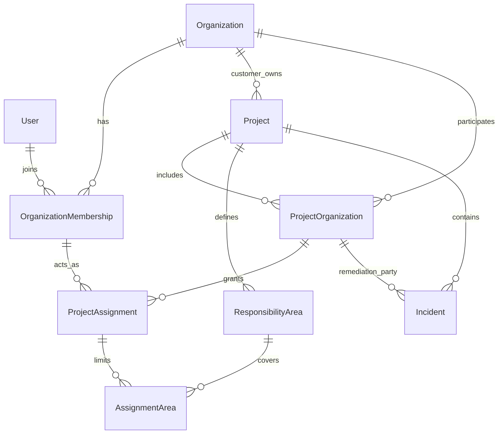

# Контроль строительства заказчиком: архитектура развития

Дата обследования: **20 октября 2026 года**. Репозиторий: `LTC-stroy-control`, ветка `main`, HEAD на начало обследования `d503bd9`. Решение: расширить существующий FastAPI / SQLAlchemy / Celery / React проект. Этот документ — проект архитектуры, не описание уже внедрённой системы.

## 1. Продукт и границы первого релиза

**«От требования в ППР до подтверждённого устранения на стройке».**

Покупатель — организация заказчика строительства. Она получает проверяемую цепочку: оригинал документа → конкретная редакция требования и страница → утверждение заказчиком → наблюдение камеры или записи → проверка человеком → ответственная организация и исполнитель → доказательства исправления → приёмка заказчиком. Возможность открыть основание каждого решения важнее количества автоматически созданных предупреждений.

Три рабочие роли — управляющий заказчика, прораб подрядчика и инженер ПТО. Это полномочия в конкретном объекте от конкретной организации, не тарифы и не неизменные свойства человека. Инженер ПТО заказчика и инженер ПТО подрядчика имеют одинаковую документную функцию, но разную видимость данных.

**Обязательный первый релиз (R1):**

1. Организации, участие подрядчиков, членство и назначения; изоляция всех API, файлов, отчётов и фоновых результатов.
2. Три рабочих интерфейса на существующей оболочке; отдельный режим чтения для мигрированных наблюдателей.
3. Версии ППР и требований, проверка инженером, явное утверждение заказчиком, атомарное включение набора правил.
4. Единый цикл обработки технических и safety-событий, доказательства устранения, человеческая приёмка, оспаривание и история.
5. Безопасные переносы камер, сохранение защиты от повторов и ограничений качества наблюдения.
6. Неизменяемая общая демонстрация, изолированный объект жюри, миграция без потери старых ID и доказательств.
7. Измеримые показатели и проверки изоляции до допуска нескольких заказчиков.

**После R1:** ограниченное делегирование приёмки представителю заказчика, SSO/MFA, группы и массовый импорт назначений, мобильные/offline-загрузки, автоматическая подготовка обезличенных фрагментов, полноценный граф работ/субподряда, новые типы машинно проверяемых требований, криптографическое закрепление журнала, PostgreSQL RLS как дополнительный барьер. Они не заменяют обязательные проверки R1. Финансовая модель и автоматические штрафы в этот объём не входят.

## 2. Что фактически найдено в проекте

### 2.1. Метод и ограничения обследования

Изучены исходники текущего рабочего дерева, модели, HTTP-маршруты, фоновые обработчики, миграции, интерфейсы и соответствующие тесты. README использовался как навигация, не как доказательство работоспособности.

На начало работы `git status` показывал **46 изменённых отслеживаемых файлов**, а также множество неотслеживаемых файлов. Среди них — ППР, анализ записей, тесты приватности и миграции `20261020_1300`–`20261020_1600`. Архитектура учитывает именно это дерево. Не следует откатывать его к HEAD или повторно реализовывать найденные возможности.

Приложение и тесты в рамках этого архитектурного задания не запускались; рабочая БД, сервер, внешний ИИ и фактическая конфигурация развёртывания не проверялись. Наличие теста означает наличие проверяемого сценария, а не подтверждённый успешный прогон. Состояние миграций в реальной БД неизвестно. При подготовке документа прикладные файлы не изменялись.

### 2.2. Инвентаризация

Все ссылки ниже относятся к реальным файлам относительно этого документа.

| Область | Существует в текущем коде | Частично / отсутствует относительно цели |
|---|---|---|
| Основа | FastAPI, SQLAlchemy 2, Pydantic 2, Celery, Alembic; React 19, TypeScript, Vite: [backend/pyproject.toml](../backend/pyproject.toml), [package.json](../package.json), [router.py](../backend/app/api/v1/router.py) | Нет причины менять стек или выделять микросервисы |
| Пользователи | JWT, регистрация, активность пользователя; `User.role = admin/manager/inspector/viewer`: [user.py](../backend/app/models/user.py), [auth.py](../backend/app/api/v1/auth.py), [deps.py](../backend/app/api/deps.py) | Роль глобальная. Первый зарегистрированный получает `admin`, остальные — `manager`. Нет организаций, приглашений в организацию и проектных назначений |
| Объекты | `Project`, `Zone`, `Camera`, настройки, `owner_username`: [project.py](../backend/app/models/project.py), [projects.py](../backend/app/api/v1/projects.py) | Владелец задан строкой логина. Это пользовательская приватность, не модель B2B |
| Доступ | `require_project`: admin / владелец / общий demo; отдельные проверки назначенного получателя инцидента: [context.py](../backend/app/services/management/context.py), [incidents.py](../backend/app/api/v1/incidents.py) | Нет границы заказчика и двух подрядчиков одного объекта; историческое назначение местами само даёт доступ |
| Демо | Общим признаётся только `MANAGEMENT-DEMO` с `owner_username is None`: [project_access.py](../backend/app/services/project_access.py) | `require_project(write=True)` запрещает запись только viewer. Общий demo доступен для изменений другим ролям; это подтверждено и ожиданиями [test_shared_demo_access.py](../backend/tests/test_shared_demo_access.py) |
| Камеры | Настройка, эталон/предложение, перенос, срок, история, сравнение ракурса; утверждение глобальным admin: [camera_views.py](../backend/app/api/v1/camera_views.py), [camera_view.py](../backend/app/services/camera_view.py), [модель истории](../backend/app/models/camera_view.py) | Полномочия не привязаны к заказчику; утверждение эталона может закрывать события ракурса. Нужны явная приёмка восстановления и версия конфигурации покрытия |
| Повтор записи | Клиентский контроль повторов и отдельное событие `STREAM_LOOP`; перепроверка не закрывает его автоматически: [engine.ts](../src/sverka/engine.ts), [alert_service.py](../backend/app/services/alert_service.py), [test_camera_loop.py](../backend/tests/test_camera_loop.py) | Не считать это доказанной защитой всех каналов/источников. Требуются регрессии при переносе правил на сервер |
| Записи и YOLO | Загрузка, библиотека, readiness отдельно от analysis status, фоновый разбор, синхронные окна, companion-ракурсы: [videos.py](../backend/app/api/v1/videos.py), [recording_analysis.py](../backend/app/services/recording_analysis.py), [recording_tasks.py](../backend/app/workers/recording_tasks.py) | Нет принадлежности записи подрядчику и общей политики раскрытия. Фактическая готовность весов/провайдеров не проверялась |
| Доказательства событий | `Incident`, `IncidentEvent`, `IncidentEvidence`, JSON explanation, фотоальбомы, назначения и сроки: [incident.py](../backend/app/models/incident.py), [incidents.py](../backend/app/api/v1/incidents.py) | Не весь материал хранится через `IncidentEvidence`: часть фото — ссылки в JSON. Нет полноценной подачи исправления, приёмки заказчиком и спора |
| Автозакрытие | `apply_verification()` переводит событие в `RESOLVED` при `passed`: [alert_service.py](../backend/app/services/alert_service.py) | Противоречит целевой человеческой приёмке. Старые закрытия нельзя переименовать в подтверждение заказчиком |
| Safety | Отдельные `SafetyEvent`, снимки, hash, snapshot, статусы candidate/confirmed/rejected и review: [safety.py, модель](../backend/app/models/safety.py), [safety.py, API](../backend/app/api/v1/safety.py) | Не подключены к полному циклу устранения. Доступ ответственного за одну safety-зону местами распространяется на весь проект |
| Оригиналы ППР | Private storage, SHA-256, уникальность `(project_id, sha256)`, PDF/изображения/DOCX, защищённое чтение: [ppr_document.py](../backend/app/models/ppr_document.py), [ppr_documents.py, сервис](../backend/app/services/ppr_documents.py), [API](../backend/app/api/v1/ppr_documents.py) | Нет семейства версий и принадлежности подрядчику; одинаковые bytes дедуплицируются на весь объект |
| Разбор ППР | Durable analysis, страницы, извлечение/OCR, проверка цитат, source preview, ограничения поддерживаемых требований: [ppr_analysis.py](../backend/app/services/ppr_analysis.py), [ppr_extraction.py](../backend/app/services/ppr_extraction.py), [модели](../backend/app/models/ppr_analysis.py) | Один `PprAnalysis` на документ; отдельные требования автоматически получают `active=True` при цифровом источнике и общем scope. Проверка цитаты не равна утверждению заказчиком |
| Требования в обнаружении | Активные требования, привязка к этапу, подавление конфликтующих классов, цитаты и revision в событиях: [ppr_rules.py](../backend/app/services/ppr_rules.py), [ppr_control.py](../backend/app/api/v1/ppr_control.py), [test_ppr_rule_integration.py](../backend/tests/test_ppr_rule_integration.py) | `active/applicability/stage_id` меняются на месте. Нет неизменяемого утверждённого выпуска и выбора его по времени съёмки |
| Дедупликация | dedup key + ППР revision, блокировки объекта/инцидента, повторное использование окна/эпизода записи, сохранение закрытого эпизода: [recording_analysis.py](../backend/app/services/recording_analysis.py), [test_recording_analysis.py](../backend/tests/test_recording_analysis.py) | Это не один уникальный SQL constraint для всех путей. Новый статус ожидания приёмки необходимо включить в открытые состояния; конкурентность требует PostgreSQL-теста |
| Файлы/отчёты | Оригиналы ППР, страницы и изображения эталона проверяют доступ | [main.py](../backend/app/main.py) публикует `storage_local_root` через `/media`; [videos.py](../backend/app/api/v1/videos.py) возвращает такие ссылки. [reports.py](../backend/app/api/v1/reports.py) содержит маршруты без `CurrentUser`. Нельзя считать данные полностью изолированными |
| Уведомления/аудит | История инцидента, камер и уведомления: [alert.py](../backend/app/models/alert.py), [alerts.py](../backend/app/api/v1/alerts.py) | Нет общего аудита членства, публикации документов и решений. Fallback назначения — глобальный admin; старые уведомления и отправка email не везде перепроверяют текущий доступ |
| UX | Основной интерфейс — `SverkaApp`, старый доступен через `#legacy`: [main.tsx](../src/main.tsx). Есть документы, страницы ППР, альбом, задачи/уведомления | [model.ts](../src/sverka/model.ts) подписывает всех «Прораб». Настройки частично в localStorage. [Tasks.tsx](../src/sverka/parts/Tasks.tsx) — краткий список уведомлений, не полноценная рабочая очередь |

### 2.3. Что нельзя принять за завершённую безопасность

До реальной многопользовательской эксплуатации устранить следующие пути обхода в R1:

- Публичные `/media`, отчёты/расписания отчётов без проверки проекта.
- `videos.py`: proxy/check-stream с передаваемым URL и raw inference без предметной авторизации; настройки сети и защита от SSRF должны использовать правила защищённого захвата из `camera_view.py`.
- Доступ safety по любой назначенной зоне и по старому snapshot; доступ к Incident по старому `assigned_user_id`.
- Глобальные `/auth/admins`, recipient/fallback на первого admin; утечки через списки пользователей, уведомления, агрегаты и экспорт.
- Клиентское влияние на длительность/исключения контроля. В R1 persisted-событие принимается только после серверной верификации источника, окна и утверждённой конфигурации; браузер не задаёт политику.

Это выводы по коду. Не утверждается, что перечисленные маршруты доступны из интернета на текущем сервере.

## 3. Решения и причины

| Решение | Причина |
|---|---|
| Один объект имеет одну организацию заказчика-владельца | Простая и проверяемая граница tenant. Совместное владение несколькими заказчиками отложено |
| Организация может быть заказчиком в одном объекте и подрядчиком в другом | Тип организации не должен навсегда определять её роль |
| Участие организации и назначение человека — отдельные связи | Приглашение подрядчика не открывает объект всем его сотрудникам |
| Рабочая роль задаётся назначению на объект; административные возможности организации — членству | Управляющий объектом не становится администратором всей платформы |
| В запросе выбран один контекст действующей организации и назначения | Не объединяем полномочия подрядчика и заказчика одного человека |
| Фиксированная матрица разрешений в коде, без конструктора IAM | Для трёх ролей не нужны пользовательские политики, deny-правила и произвольный граф наследования |
| Основа области ответственности — существующие зоны и этапы | Не вводим ERP/WBS. Добавляем только именованную область для комбинации зоны/этапа |
| Подтверждение нарушения и приёмка устранения — решения заказчика | ИИ создаёт проверяемую гипотезу и вспомогательную перепроверку |
| Утверждение ППР — пакетом точных редакций с датой действия | Снижает ежедневную нагрузку, не допускает незаметной смены правила |
| Оспаривание — отдельная сущность | Не теряем текущий статус работ, историю и первоначальный вывод |
| Основание события неизменно; наблюдения и исправления добавляются | Можно объяснить старое решение после смены ППР, модели или подрядчика |
| Архивирование вместо удаления бизнес-доказательств | FK/cascade текущей схемы не должны уничтожать историю |

В R1 несколько управляющих заказчика могут обслуживать объект; задаётся заместитель и очередь решений. Загрузка ППР, принятие задачи в работу, комментарии, предложение ракурса и подача доказательств не требуют предварительного согласования. Пакетное решение содержит отдельный результат и `expected_version` для каждой карточки; «принять всё без просмотра» не предусматривается. Высокие/критические риски, оспаривания, изменение правил и восстановление контроля принимаются индивидуально.

## 4. Организации, объекты и доступ

### 4.1. Минимальная модель



- **Organization**: UUID, название, статус. Не является тарифом или глобальной ролью.
- **OrganizationMembership**: организация, пользователь, `active/revoked`, административные флаги `can_manage_members`, `can_create_projects`. Они не дают чтения всех проектов/доказательств. Первое создание организации и её первого администратора — отдельный контролируемый onboarding, не «первый пользователь = admin».
- **Project**: существующий UUID; `customer_organization_id`, `kind=production/shared_demo/jury`, lifecycle `active/archived`. В R1 владелец не переносится другому заказчику обычным PATCH.
- **ProjectOrganization**: UUID участия, объект, организация, `side=customer/contractor`, `status=invited/active/ended`. Ровно одно customer-участие совпадает с владельцем Project. Повторное привлечение того же подрядчика реактивирует связь с новой записью периода участия; история периодов сохраняется.
- **ProjectAssignment**: UUID, участие, членство, `role=customer_manager/contractor_foreman/pto_engineer/project_viewer`, `status=active/revoked`, scope. Последняя роль — совместимый режим чтения, не четвёртая продуктовая роль и не тариф. Одному человеку допустимы разные назначения и несколько ролей, но конкретный запрос выполняется от одного назначения.
- **ResponsibilityArea**: UUID, project, название, `zone_id?`, `schedule_task_id?`; минимум одно из двух обязательно. При двух полях условия пересекаются, а не объединяются. Этап с собственной зоной должен ей соответствовать. Это предметная область работ, не отдельный tenant.
- **AssignmentArea**: явные строки `(assignment_id, area_id)`. Пустой список у ограниченного назначения означает отсутствие доступа, а не весь объект. Customer manager имеет `scope=project`. ПТО заказчика может иметь весь объект или ограниченный набор; подрядчик — только непустой набор утверждённых областей.

Один и тот же пользователь может быть инженером организации А на объекте X и прорабом организации Б на Y. На X права Б не добавляются к правам А. Смена контекста в UI сбрасывает данные, кэш, выделение и незавершённые запросы.

### 4.2. Правило серверной авторизации

Для каждого списка, детали, команды и файла:

1. Проверить токен как идентичность и `User.is_active`; роль из JWT не использовать как разрешение.
2. По серверным данным проверить действующее членство, участие и назначение. Переданные `organization_id`/`assignment_id` — только указатели для проверки.
3. Загрузить ресурс через разрешённый объект. Проверить соответствие всех вложенных UUID объекту и выбранной стороне.
4. Проверить разрешение из фиксированной матрицы и состояние ресурса.
5. Проверить видимость ресурса, область ответственности и отдельное право на содержимое файла.
6. Проверить запрет изменения shared demo/архива, конфликт интересов, текущую версию. Повторить значимые проверки под блокировкой при записи.
7. Одной транзакцией записать изменение, аудит и outbox уведомления.

**Формула для подрядчика:** активный пользователь ∧ членство ∧ активное участие ∧ назначение ∧ разрешённая область ∧ (ресурс принадлежит его участию или явно опубликован для него). Совпадения зоны недостаточно. Назначение на событие не обходит отозванное членство.

Управляющий заказчика видит все данные своих назначенных объектов. Обзор организации агрегирует только такие объекты. `can_manage_members` не раскрывает чужие клиентские проекты. Все query-фильтры применяются **до** сортировки, пагинации, count, поиска и агрегации; нельзя сначала выбрать весь объект и фильтровать только ответ.

Если ресурс чужой или не виден — `404 RESOURCE_NOT_FOUND`, без подтверждения его существования. Если ресурс виден, но действие запрещено — `403 ACTION_FORBIDDEN` с безопасным объяснением. Не передавать клиенту скрытого подрядчика или имя ответственного из чужой области.

### 4.3. Видимость по классам данных

| Данные | Заказчик | Подрядчик |
|---|---|---|
| Паспорт объекта, перечень его областей | По назначению | Минимальный паспорт и назначенные области; без полного списка других подрядчиков |
| Черновик ППР/разбор | ПТО и управляющий заказчика | ПТО организации-владельца документа в разрешённой области |
| Проверенные/утверждённые требования | Весь доступный объект | Свои и явно опубликованные общие требования соответствующих работ |
| Полный оригинал ППР | По документным полномочиям | Только свой или отдельно предоставленный оригинал; ссылка на требование не открывает библиотеку |
| Нераспределённый кандидат события | Управляющие заказчика | Не виден |
| Назначенный и явно опубликованный кандидат | Управляющие заказчика | Прораб своей стороны может читать, комментировать и приложить материал; не подтверждать |
| Карточка нарушения | Управляющие; ПТО — связанные документные основания | Текущая ответственная сторона + область; прораб — рабочая карточка, ПТО — только документный контекст |
| Камера/поток/запись | По camera/video полномочиям | Только явно разрешённые источники в своей области; запрет на stream credentials |
| Фото/страница в деле | По доступу к конкретному материалу | Только опубликованные для стороны материалы этого дела |
| Отчёты, поиск, уведомления, история | Та же область данных | Та же область; не «весь проект» через экспорт или агрегат |

Для раскрытия нужны **предметные** связи `document_shares`, `camera_shares`, `video_shares`, `evidence_disclosures`, а не универсальная ACL на любую строку. Они указывают участие получателя, разрешённый вид чтения и при необходимости область. Изменять их может заказчик; получатель не расширяет публикацию.

Публикация общего требования не означает публикацию всего ППР. Источник в деле даёт доступ к проверенной конкретной странице/фрагменту, если это разрешено `evidence_disclosure`. Страница сохраняет номер и hash оригинала; полный оригинал отдельно. Если на странице или в кадре есть чужие данные, исходник остаётся у заказчика, а подрядчику публикуется проверенный фрагмент/производная с привязкой к оригиналу. В R1 допустима ручная подготовка безопасного фрагмента; автоматическое обезличивание не является обязательной зависимостью.

Для камеры, охватывающей двух подрядчиков, автоматическое совпадение области **не** даёт каждому весь поток. По умолчанию доступны опубликованные доказательства; полный поток/запись требуют отдельного разрешения заказчика. Скрытые URL, абсолютные storage paths и пароли не возвращаются даже в недоступных кнопках.

### 4.4. Конфликты интересов и отзыв

Человек с членством у обеих сторон может работать в разных контекстах, но не принимает собственное исправление и не рассматривает собственное оспаривание. Проверка по `user_id`, не только по текущему назначению. Утверждение ППР, приёмка и спор по работам подрядчика недоступны customer manager, если он имеет действующее назначение от этого подрядчика на том же объекте. Дополнительно проверяется сохранённый контекст автора/подающего пакет и каждой утверждаемой редакции: отзыв подрядного назначения или подача пакета коллегой не позволяет затем утвердить собственный материал от имени заказчика. Другой управляющий заказчика принимает решение.

Документ, подготовленный ПТО, может утвердить управляющий того же заказчика. Если один человек совмещает ПТО и управляющего **только на стороне заказчика**, и авторство/подача данного пакета происходили исключительно от заказчика, самопроверка допускается для обычного ППР с явной записью в аудите; политика «два человека» — последующее усиление. Это не разрешает подрядчику утверждать собственный документ сменой контекста или отзывом назначения.

Отзыв членства или назначения вступает в силу со следующего запроса, включая старый JWT, файл, Range-запрос и уведомление. Уже скачанные bytes отозвать невозможно. Исторические `uploaded_by`, `assigned_user_id`, snapshot и audit не являются grant. Не удаляем пользователя/членство физически.

В R1 полномочия читаются из БД без долгого кэша; если вводится кэш, ключ включает `authorization_version`, обновляемый при отзыве. Список уведомлений, экспорт и доставка outbox перепроверяют текущую доступность. Если право отозвано во время фоновой задачи, результат сохраняется в объекте, но бывшему участнику не выдаётся и не отправляется.

Нельзя отозвать последнее активное назначение управляющего действующего объекта без передачи полномочий либо архивирования. Избыточные глобальные admin-обходы удаляются. Сервисное обслуживание платформы — отдельный служебный контур; оно не становится четвёртой бизнес-ролью.

## 5. Матрица разрешений R1

Обозначения: **О** — назначенный объект заказчика; **С** — свой подрядчик и разрешённая область; **Д** — доступный документный контекст; **П** — явно опубликованные материалы. «Нет» означает серверный запрет. `project_viewer` получает только разрешённые чтения соответствующей стороны, без записей.

| Действия / разрешения | Управляющий заказчика | Прораб подрядчика | ПТО заказчика / ПТО подрядчика |
|---|---|---|---|
| Просмотр объектов `project.read` | О, сводка своих назначений | С, минимальный паспорт | Д / С |
| Создать объект `project.create` | Только с `can_create_projects` своего членства; создатель получает manager assignment | Нет | Нет |
| Изменить/архивировать объект `project.manage` | О; передача нерешённых дел обязательна | Нет | Нет |
| Пригласить/завершить участие подрядчика `participation.manage` | О | Нет; может запросить замену | Нет |
| Назначить людей/роли/области `assignment.manage` | О, только в активные участия | Нет; предлагает кандидата | Нет |
| Членство организации `membership.manage` | Только с отдельным флагом членства, в своей организации | Только у назначенного администратора организации, вне роли прораба | Аналогично; роль ПТО сама флаг не даёт |
| Камеры `camera.read`, `camera.configure` | О: читать, подключать, менять; отключение с причиной и периодом | П: читать метаданные/разрешённый поток; не отключать | Нет рабочего управления; только статус покрытия в документном контексте |
| Эталон `camera.reference.propose/approve` | О: предложить, утвердить версию | С+П: предложить | Нет |
| Перенос `camera.move.request/decide/restore` | О: решение, проверка восстановления | С+П: запрос, отметка выполнения, новый ракурс | Нет |
| Записи `video.read/upload/analyze` | О | П читать; загрузить свою запись в С, запуск серверной обработки по политике | Нет видеобиблиотеки; только опубликованный материал связанного дела |
| Оригиналы `document.read/upload` | О | П читать, загрузка ППР через ПТО | ПТО заказчика — Д; подрядчика — свои Д/С и П |
| Разбор `document.analyze`, редактирование `requirement.edit` | О | Нет; комментарий к применимости через дело | Д / свои Д в С |
| Отправка `control.submit` | О | Нет | Д / свои Д в С; пакет для заказчика |
| Утверждение/вывод из контроля `control.approve/publish/retire` | О, проверка конфликта интересов | Нет | Нет |
| Просмотр событий `incident.read` | О | С, опубликованная карточка | Связанный Д-контекст, без всей очереди чужих работ |
| Подтвердить/отклонить обнаружение `incident.confirm/dismiss` | О | Нет; может сообщить согласие или спор | Нет; документный комментарий |
| Назначить сторону и срок `incident.assign/deadline` | О; допускается утверждённая автоматическая маршрутизация | Нет переноса срока/смены подрядчика; запрос заказчику | Нет |
| Начать работу `incident.start` | Только технический сбой контроля на стороне заказчика; не работы подрядчика | Назначенный прораб С | Нет |
| Сообщить об исправлении `remediation.submit` | Только `control_integrity` на стороне заказчика, принимает другой manager | Назначенный прораб С | Нет |
| Принять/вернуть `remediation.accept/return` | О; независимый от исполнителя человек | Нет | Нет |
| Оспорить `dispute.open` | Может инициировать проверку, но не спорить от подрядчика | С: с причиной и приложениями | Подрядчик: документное оспаривание в С; заказчик: комментарий |
| Решить спор `dispute.decide` | О; не автор спора/исходного решения | Нет | Нет |
| Доказательства `evidence.read/append` | О; публикация сторонам | П чтение, добавление своих материалов по делу | Д: документные приложения и комментарии |
| Удалить/заменить доказательство | Нет; только новая версия/пометка, исходник сохраняется | Нет | Нет |
| Отчёты `report.read/create` | О, данные только своей организации | С, исполнение своих задач | Д, реестр документов/согласований |
| Журнал `audit.read` | О, включая права и решения; секреты исключены | История доступных дел и собственных действий С | История документов/связанных решений Д |

Администратор подрядной организации может подтвердить членство собственного сотрудника через отдельный минимальный экран приглашений. Это не даёт ему права назначить себя на объект, менять роль или расширять области. Если контакт-приглашаемый — первый сотрудник новой организации, он завершает onboarding по связанному одноразовому приглашению; управляющий заказчика не может тайно присоединить человека к чужой существующей организации.

**Заказчик обязателен:** утверждение требований и изменений контроля, раскрытие чужих материалов, подтверждение/отклонение нарушения, окончательная приёмка, решение спора, смена ответственной организации, продление срока, перенос/восстановление камеры, отзыв доступа и архив. Остальные рабочие действия выполняются в пределах выданного назначения без согласования.

## 6. Состояния и пользовательские сценарии

### 6.1. Событие, работа и приёмка

Оставляем совместимые значения `IncidentStatus` и добавляем одно состояние:

```text
pending → confirmed → in_progress → remediation_submitted → resolved
   └───────────────→ false_positive
confirmed / in_progress / remediation_submitted → false_positive
remediation_submitted → in_progress  (возврат)
```

`pending` — обнаружен **кандидат**, а не установленное нарушение. `confirmed` — заказчик подтвердил нарушение. `remediation_submitted` — прораб сообщил об исправлении, приёмки ещё нет. `resolved` новых дел — заказчик принял конкретную подачу доказательств.

| Команда | Исходное состояние → результат | Условия |
|---|---|---|
| `confirm` | pending → confirmed | Человек заказчика просмотрел основание; указаны сторона, область и срок. Без стороны дело остаётся pending в очереди назначения |
| `dismiss` | pending → false_positive | Причина, комментарий, reviewer |
| `assign` / `change_deadline` | Любое открытое → то же | Заказчик, история назначения/срока; нельзя подменить источник |
| `start` | confirmed → in_progress | Действующий назначенный прораб; для технического контроля заказчика — назначенный manager. Исполнитель не подтверждает факт вместо заказчика |
| `submit_remediation` | confirmed или in_progress → remediation_submitted | Описание, ≥1 доступного валидного доказательства; создаётся неизменяемая подача с номером |
| `accept_remediation` | remediation_submitted → resolved | Заказчик, точная последняя подача, нет открытого спора и конфликта интересов |
| `return_remediation` | remediation_submitted → in_progress | Причина и требуемое дополнение; предыдущая подача сохраняется |
| `uphold_dispute` | Открытое → false_positive | Только если спор отменяет сам факт нарушения; другое исправление решения может оставить статус |

Закрытые состояния не открываются автоматически. Повтор того же эпизода добавляет только допустимое восстановление утраченного доказательства и не меняет решение. Новый эпизод после наблюдаемого разрыва — новое дело с `related_incident_id`. Ошибка исторической приёмки исправляется отдельной записью пересмотра с причиной; в R1 новое связанное дело, исходное решение остаётся видимым.

**Три срока:** `reaction_due_at` — заказчику проверить кандидата; `remediation_due_at` — подрядчику подать исправление; `review_due_at` — заказчику принять подачу. Сроки по умолчанию вычисляются из утверждённой версии политики объекта и серверного времени. UTC в БД, часовой пояс объекта при отображении. Подача доказательств не меняет исходный срок; период ожидания приёмки показывается отдельно. Возврат не обнуляет предыдущую просрочку, новый срок задаётся явным решением с историей.

`verification_status` камеры становится независимым результатом `not_requested/queued/passed/failed/unavailable`, без изменения бизнес-статуса. `passed` означает «повторная проверка не обнаружила признак», а не «заказчик принял устранение».

`case_kind=construction/control_integrity` различает строительное нарушение и сбой контроля. Для камеры заказчика `responsible_participation_id` может указывать customer participation: manager подаёт материалы восстановления, **другой** manager принимает. При отсутствии второго дело ждёт назначения проверяющего, не автозакрывается. Для строительных нарушений ответственная сторона — подрядчик. `area_id` обязателен для строительного дела и для любого подрядного назначения; только техническое дело заказчика по конкретной собственной камере допускает null area. Это исключение не даёт manager права подать устранение от имени подрядчика.

Начало reaction SLA — `detected_at` (создание кандидата сервером), не давнее время съёмки записи; начало срока устранения — человеческое подтверждение. `first_seen_at` остаётся временем первого наблюдения.

### 6.2. ППР, проверка и выпуск контроля

Не смешиваем статусы технического разбора и утверждения:

- Разбор: совместимые `PENDING/RUNNING/COMPLETED/PARTIAL/FAILED`.
- Проверка редакции требования инженером: `needs_review/verified/excluded`.
- Пакет контроля `ControlRelease`: `draft → in_review → scheduled → active → retired`; `in_review → changes_requested → draft`; `draft/in_review/changes_requested/scheduled → cancelled`.
- `scheduled` означает «утверждён человеком, ожидает effective_from»; при немедленном включении транзакция проходит утверждение и переводит выпуск в `active`. Время, субъект и решение утверждения сохраняются независимо от текущего состояния.

Выпуск содержит точный **полный** набор редакций требований объекта с областями и ответственными сторонами. В R1 это одна последовательность выпусков на объект, чтобы избежать пересекающихся частичных политик. Инженер подрядчика отправляет изменения своих требований; сервер строит полный пакет поверх текущего выпуска, а UI показывает ему только разрешённую часть. Он не может удалять/менять невидимые элементы. Заказчик проверяет diff целиком.

Редакция требования после включения в отправленный пакет неизменяема. Возврат создаёт следующую редакцию/версию пакета, старый отправленный snapshot сохраняется. `verified` означает проверенную цитату и применимость; «утверждено» вычисляется по решению о выпуске, «действует» — по действующему временному интервалу и scope. Булевый `active` больше не является самостоятельной командой.

Ошибки страниц не скрываются: можно утвердить явно перечисленные проверенные требования при `PARTIAL`, приняв ограничения и указав непроверенные страницы. Нельзя показывать весь документ проверенным. Неподдерживаемые моделью требования остаются в ручном контроле; наличие утверждения не делает их автоматически детектируемыми.

### 6.3. Сквозные сценарии

**1. Заказчик создаёт объект и приглашает подрядчика.**

Участник с `can_create_projects` выбирает свою организацию → создаёт объект и customer participation → получает назначение manager → задаёт зоны/этапы, политику сроков и заместителя → создаёт приглашение подрядчику с областями и сроком действия. Приглашение адресовано проверяемому контакту/аккаунту, хранится hash одноразового токена; `pending/accepted/expired/revoked`.

После принятия участия менеджер назначает сотрудников. Просроченный или отозванный токен не оживляет доступ; повтор принятия возвращает тот же результат. Приглашение существующей организации требует подтверждения её администратора. Совпадение названия/email-домена не сливает организации. Уведомление получает только приглашённый контакт; письмо содержит минимум данных и ссылку после авторизации.

**2. Назначение прораба и инженера.**

Управляющий выбирает активное участие и подтверждённых членов организации → роль → области → дату начала. Прораб назначается только от подрядчика; manager — только от заказчика; ПТО — от любой стороны, с явной подписью организации. Для нового сотрудника приглашение в членство и назначение завершаются последовательно; до принятия нет доступа. Прораб может предложить коллегу, но не утвердить права. Уведомление о назначении содержит объект и область.

**3. ППР → ИИ → проверка → утверждение → контроль.**

ПТО загружает оригинал в своё семейство документов → сервер сохраняет bytes/hash и версию → outbox ставит анализ → UI показывает страницы и ошибки → ПТО проверяет цитаты, номер страницы, класс, условие, область/этап, поддержку детектором → сохраняет редакции → отправляет пакет.

Управляющий получает diff правил, ограничения и конфликты → возвращает с комментарием либо утверждает `effective_from` → сервер атомарно публикует выпуск и уведомляет затронутые назначения. Нет автоматического включения по результату ИИ. Конфликт обязательной/запрещённой техники в пересекающейся области и времени блокирует публикацию; неоднозначный текст остаётся ручным требованием.

Повтор запроса не создаёт второй документ/анализ. Неверная цитата, неизвестная страница, чужой stage ID — ошибка валидации. Если файл уже существует **в недоступной библиотеке другого подрядчика**, ответ не раскрывает его имя, автора и ID.

**4. Обнаружение → задача → исправление → приёмка.**

Сервер получает валидное окно наблюдений → сохраняет основание и фото → дедуплицирует → создаёт `pending`. Маршрутизация предлагает ответственного по области/работе; при неоднозначности дело остаётся только в очереди заказчика. Заказчик подтверждает и назначает. После этого прораб получает задачу, принимает в работу, прикладывает материалы «после» и описание, отправляет подачу.

Заказчик видит «до/после», конкретную версию требования и комментарий; повторная проверка камеры показана отдельно. Принимает или возвращает. Недостаточность камеры не запрещает ручную приёмку по иным проверяемым доказательствам, но требует указания основания. Уведомления: candidate→reviewers, назначение→прораб, подача→очередь заказчика, возврат/приёмка→исполнитель. Эскалации идут только действующим уполномоченным этого объекта.

Прораб может немедленно исправить опасную ситуацию до формального подтверждения и добавить материалы к **уже назначенному и опубликованному ему** `pending`; они сохраняются как приложения, но не обходят подтверждение и приёмку. Нераспределённые кандидаты остаются невидимыми подрядчику. Продукт не даёт указаний продолжать опасные работы до решения в UI.

**5. Оспаривание.**

Прораб либо ПТО подрядчика открывает `Dispute(open)` по доступному делу с причиной (`wrong_detection`, `wrong_requirement`, `wrong_scope`, `insufficient_evidence`, `other`), объяснением и приложениями. Заказчик получает отдельную очередь. Автор исходного подтверждения не решает спор; требуется другой manager.

Состояния спора: `open → upheld/rejected/withdrawn`; решения неизменяемы, повторный спор создаёт новую запись. Если спор признан по факту — `false_positive`; если только неверный срок/ответственный — отдельная исправляющая команда, статус работ сохраняется. Отказ требует мотивировки. Открытый спор не выключает наблюдение и не останавливает срок автоматически. Заказчик может явно приостановить отсчёт срока устранения с основанием и периодом; история и отдельный индикатор сохраняются. Приёмка блокируется до решения/отзыва открытого спора.

Если спор подан по закрытому делу, в R1 создаётся связанная заявка на пересмотр без изменения исторического статуса и KPI до решения. Нет бесследного редактирования старого review.

**6. Перенос камеры и восстановление.**

Прораб выбирает разрешённую камеру → причина, желаемое окно, план временного покрытия → `requested`. Заказчик одобряет точное окно либо отклоняет. Запрос сам по себе не подавляет тревоги.

Состояния запроса: `requested → approved → in_progress → awaiting_reference → completed`; `requested → rejected/cancelled`, `approved → cancelled`, незавершённое согласованное окно → `expired`. Только разрешённое окно ограничивает ожидаемые события изменения ракурса; оно не удаляет старые события и не выключает всю систему.

Во время переноса зона помечена `insufficient coverage`; выводы об отсутствии техники запрещены там, где нет требуемого покрытия. После монтажа прораб предлагает свежий ракурс; заказчик проверяет источник/время, покрытие и утверждает новую версию эталона. Только затем `completed` и возобновление соответствующего контроля. Истечение окна создаёт задачу заказчику/исполнителю, а не ложный статус «контроль восстановлен». Утверждение ракурса само не закрывает несвязанные нарушения.

**7. Замена ППР новой версией.**

Новая загрузка привязана к `DocumentSeries` и `supersedes_document_id`, старые bytes/страницы остаются. Старый выпуск продолжает действовать во время разбора и проверки нового. Diff показывает добавленные, изменённые, исключённые требования и затронутые работы. Заказчик утверждает новый полный набор; переключение по `effective_from` атомарно.

Обнаружения используют выпуск на **время съёмки**, не время обработки. До начала зарегистрированной истории правил старую запись можно анализировать только как явно помеченный ретроспективный разбор по выбранному выпуску; результат не выдаётся за нарушение действовавших тогда правил. Это отдельный draft review, не автоматическая задача подрядчику. Окно наблюдения обрывается на границе версии, области, смены или качества источника.

Замена не исправляет цитаты в старых делах. Недействительное требование отзывается новым решением с датой, а связанные открытые дела попадают на проверку заказчика; они не исчезают и не закрываются автоматически.

**8. Смена подрядчика или ответственного.**

При смене сотрудника сохраняем ответственное участие подрядчика, прежние назначения и сроки; новый прораб получает незавершённые задачи через подтверждённое назначение. Автоматический подбор допускается только по однозначной утверждённой таблице маршрутизации.

При смене подрядчика различаем `origin_participation_id` (к кому относилось обнаружение, если установлено) и `responsible_participation_id` (кто сейчас устраняет). Заказчик передаёт выбранные дела и публикует необходимые материалы новому участнику. Это не переписывает виновность и не раскрывает всю библиотеку предшественника. Старое участие завершается, доступ прекращается; снимки имени организации и решения остаются в истории.

**9. Отзыв доступа и архивирование.**

Управляющий предварительно видит открытые задачи, согласования и роль заместителя → выбирает передачу → отзывает назначение. Критический отзыв допустим немедленно: задачи уходят в очередь заказчика без исполнителя; исходный срок сохраняется, новая причина ожидания фиксируется.

Архивирование останавливает новые загрузки, изменения, наблюдение, фоновые публикации и рассылки объекта; read-доступ сохраняется у действующих назначений. Незавершённые дела отмечены «остались открытыми при архивировании», не `resolved`. Архив не завершает все участия, иначе читать его было бы некому. Восстановление — manager-команда с проверкой актуальных назначений/источников; не автоматический запуск старых stream URL.

## 7. Хранение, версии и инварианты БД

### 7.1. Изменения схемы

Не пересоздаём существующие таблицы и ID. Новые поля сначала nullable, затем backfill, проверка и ограничения.

| Сущность | Новое / изменение | Обязательные ограничения |
|---|---|---|
| `organizations` | UUID, name, lifecycle | Имена не служат ключом идентичности |
| `organization_memberships` | org, user, status, административные флаги | Unique `(organization_id,user_id)`; отзыв сохраняет строку |
| `project_organizations` | project, org, side, status | Unique `(project_id,organization_id)`; один customer; customer org совпадает с Project |
| `participation_periods` | participation, started_at, ended_at | Непересекающиеся периоды, окончания не стирают прошлое |
| `project_assignments` | participation, membership, role, scope_kind, status | Membership и participation принадлежат одной org; роль совместима со стороной; unique активного `(participation,membership,role)` |
| `responsibility_areas`, `assignment_areas` | Связи существующих зон/этапов | Все FK одного project; минимум zone или stage |
| `invitations` | issuer, intended org/participation/role, recipient identity, token hash, expiry, status | Одноразовое принятие, область не расширяется при принятии; токен не хранится открытым |
| `projects` | customer org, kind, lifecycle, authorization_version | Существующие code/UUID сохраняются; demo определяется kind после миграции, не пользовательским code |
| `document_series` | project, owner participation, title | Версии одной серии имеют одного project/владельца |
| `ppr_documents` | series_id, version_no, supersedes_id, owner_participation_id, uploaded_by_user_id | Unique `(series_id,version_no)`; immutable bytes/hash; старый `uploaded_by` сохраняется для отображения |
| `ppr_analyses` | Убрать unique(document_id); добавить run_no, version providers/renderer | Unique `(document_id,run_no)`; завершённые результаты не перезаписывать |
| `ppr_pages` | Сохранить per-analysis pages; закрепить hash preview и renderer version | Unique `(analysis_id,page_number)`; 1-based номер; page/text/preview одной зафиксированной версии |
| `ppr_requirements` | Существующий ID — логическая идентичность/извлечённый кандидат | Старые поля используются адаптером, не источником новой политики |
| `requirement_revisions` | requirement_id, revision_no, document/page/analysis, цитата, классификация, scope, review data | Unique `(requirement_id,revision_no)`; неизменность после submit; цитата не редактирует исходник |
| `control_releases`, `control_release_items` | project, sequence, base_release_id, state, version, effective interval, approval actor, immutable manifest | Unique `(project,sequence)`; один active на момент; каждый item — точная revision и target scope; не смешивать проекты |
| `incidents` | case_kind, workflow_version, row_version, source_safety_event_id?, area, origin/current participation, assignment, detected_at, confirmed_at?, 3 срока, resolution_origin | Unique non-null safety source; assignee относится к текущей стороне/области; FK старых пользователей сохраняются как legacy |
| `incident_basis` | Один неизменяемый typed snapshot на Incident: источники, release, цитаты, модель, окно, coverage, hash | Unique incident_id; запись один раз. `explanation` остаётся legacy-проекцией |
| `incident_observations` | Новые окна/эпизоды/результаты проверки, source receipt | Append-only; unique source receipt; не меняет основание |
| `incident_assignments`, `deadline_changes` | История стороны/человека/сроков/паузы | Actor, причина, old/new, время; текущие поля Incident — проекция |
| `evidence_assets` | UUID, project, owner participation, storage key, MIME/size/hash, uploader, captured_at, received_at, source kind, integrity status | Серверная проверка файла; storage key закрыт; original append-only |
| `incident_evidence_links` | case, asset, kind, submission_id?, disclosure | Старые frame/album ссылки импортируются без потери URL/hash |
| `remediation_submissions` | case, sequence, author assignment, note, submitted_at, typed asset links | Unique `(incident,sequence)`; не редактируется после подачи |
| `remediation_reviews` | submission, reviewer, accepted/returned, note, decision time | Одно итоговое решение на подачу; повтор команды идемпотентен |
| `disputes`, `dispute_decisions` | incident, author, reason, note/evidence, outcome/correction, reviewer | Не более одного открытого спора на дело; решение append-only |
| Камеры | Версии эталона/coverage policy; отдельные `camera_move_requests` | История не затирается очередным переносом; одна активная заявка на камеру |
| Нормативы без ППР | Неизменяемые snapshots существующего `RuleSet`/профиля этапа; версии camera policy | Новые camera/catalog события не маркируются legacy; policy утверждается заказчиком с периодом действия |
| Публикации | document/camera/video shares, evidence disclosures | Получатель — участие того же объекта; отзыв влияет на выдачу файла |
| `audit_events`, `command_receipts`, `notification_outbox` | Типизированный аудит, идемпотентность команд, доставка | Unique request/idempotency scope; аудит/изменение/outbox атомарны |
| Отчёты | Actor context, scope version, cutoff, source period, provenance | Формирование и выдача повторно проверяют scope; старый общий отчёт нельзя выдать подрядчику |

Не вводить `organization_id` во все таблицы механически: `project_id → customer_organization_id` задаёт tenant, `owner/responsible participation` — сторону. Для часто используемых FK допустимы составные ограничения `(id,project_id)`; одного FK на UUID недостаточно для межпроектной целостности. Переходы состояний и принадлежность дочерних строк проверяются сервисом в транзакции; критические unique/check ограничения дублируются БД.

Каскадное удаление от Project/Camera/Frame/PprDocument в существующих моделях опасно для доказательств. В R1 публичные delete архивируют сущности; ссылки на доказательства переводятся на `RESTRICT`/сохраняемые tombstone-объекты. Очистка временных uploads отдельна от удаления принятых материалов. Политика retention задаётся заказчиком позднее; до её утверждения бизнес-доказательства не удаляются автоматически.

### 7.2. Неизменяемое основание

`incident_basis` фиксирует:

- ID/версию источника записи, физическое время съёмки и UTC-окно, offsets, hash кадров.
- Версии камеры, эталона, группы покрытия, зоны/этапа и допустимость вывода об отсутствии.
- Digest модели, версию конфигурации детектора и вычисленные наблюдения.
- `control_release_id` и manifest hash; для каждой цитаты — requirement revision, document ID/hash, analysis run, page number, page artifact hash и точный текст.
- Первоначальный тип вывода, ограничения, origin participation при известной принадлежности.

Snapshot формирует сервер из сохранённых источников. Клиент не присылает собственное «подтверждение модели», произвольную citation, готовый публичный URL или роль. Новое наблюдение, исправление распознавания и принятие спора — новые записи. Повреждённый файл можно восстановить из достоверного источника с тем же hash либо добавить новый материал с provenance; нельзя незаметно заменить исходник другими bytes.

DOCX: оригинал сохраняется, отдельный неизменяемый PDF-render имеет hash/версию конвертера. «Страница 7» относится к закреплённому render, что явно подписано; повторный рендер не меняет старую ссылку. PDF-оригинал и одностраничное представление также связаны hash. OCR-текст не заменяет изображение страницы.

### 7.3. Дедупликация и качество наблюдения

Сохраняем существующие dedup key и episode receipts при миграции. Новая схема нормализует ключ из project + область + тип + контролируемый класс + **семантический hash соответствующих требований** + группа источников. Изменение не относящегося к классу требования не должно раздваивать все открытые дела. Смена ответственного/срока не меняет ключ. Старый формат поддерживается через alias/lookup; нельзя одним backfill породить повтор всех событий.

Для создания: короткая блокировка project/ключа → поиск существующего эпизода → insert/update наблюдения. Добавить частичный unique `(project_id,dedup_key)` для открытых статусов после аудита и сохранения найденных legacy-дублей как связанных записей. Он включает `remediation_submitted`. Receipt `(source_id, sampled_bucket, inference_policy_hash)` защищает от повторного учёта одного наблюдения. Safety сохраняет свои frame receipts и однозначную связь с Incident.

Границы эпизода фиксируются явным разрывом наблюдения/подтверждённым восстановлением признака; повтор закрытой записи не открывает дело. Изменение правил внутри окна начинает новое окно. SQL-блокировки и unique проверяются на PostgreSQL, SQLite-теста недостаточно.

Отсутствие распознавания **не равно** отсутствию техники. Отрицательный вывод возможен только при подтверждённой группе требуемых ракурсов, качестве/свежести кадров, валидной модели нужного класса, непрерывном достаточном окне, рабочей смене, правильной зоне/этапе, действующем правиле и отсутствии loop/переноса/потери покрытия. Недостаток любого условия даёт `insufficient/unknown`, разрывает отрицательное окно и создаёт сигнал качества контроля. Положительное наблюдение можно сохранить при частичном покрытии с соответствующим ограничением.

Текущий `recording_analysis.py` уже прерывает окна при ошибках чтения/инференса и учитывает companion-источники. Но набор доступных файлов сам по себе не доказывает физически достаточное покрытие: R1 добавляет утверждённую конфигурацию ожидаемых ракурсов с периодом действия. `visibility_percent` не превращается в объективную полноту контроля без такого основания.

### 7.4. Safety и существующие записи

Не переписывать safety pipeline. При новом `SafetyEvent(candidate)` атомарно создавать связанную карточку Incident с `source_safety_event_id` (unique). SafetyEvent сохраняет собственные immutable bytes/snapshot; Incident хранит workflow, сторону, сроки, подачи и споры. В UI и KPI это **одно** дело.

Старые candidate/confirmed/rejected отображаются через адаптер как pending/confirmed/false_positive; происхождение старого подтверждения сохраняется, оно не автоматически становится решением уполномоченного заказчика. Старый `/safety/events/{id}/review` проходит через общий workflow service или возвращает `409 WORKFLOW_UPGRADE_REQUIRED`, но не обновляет второй независимый статус.

Старые `resolved` остаются закрытыми с `resolution_origin=legacy_auto` при `AUTO_RESOLVED`, иначе `legacy_unverified`, если нет достаточной записи человеческой приёмки. Значение `customer_accepted` присваивается только новой валидной приёмке; исторические даты не выдумываются. Старый `false_positive` также сохраняет provenance, не становится доказательством решения новой организации.

## 8. Согласованные контракты Python / TypeScript / API

### 8.1. Правила контракта

Ниже — проект **новых** контрактов, не утверждение о текущих DTO. Их место при реализации: новые `backend/app/schemas/customer_control.py`, `backend/app/services/access_policy.py`, `backend/app/services/incident_workflow.py`; TS генерируется из OpenAPI в новый `src/api/generated/customerControl.ts`. Эти файлы пока не существуют. Существующие `schemas/stroy_control.py`, `schemas/ppr_documents.py`, `sverka/api.ts`, `pprApi.ts` становятся адаптерами на время миграции.

- UUID сериализуется канонической строкой, проверяется Pydantic; строка на фронтенде не является доказательством принадлежности ресурса. Человеческие коды не используются как FK.
- Все JSON-имена — `snake_case` на обеих сторонах. Даты — RFC 3339 с timezone, сервер нормализует UTC. Номера страниц — целые от 1. Версия строки — целая от 1. Hash — 64 hex.
- Один источник перечислений — Python/OpenAPI. Не поддерживать вручную разные русские/английские статусы в `data.ts`, `model.ts` и API. Русские названия — отдельный исчерпывающий `Record<IncidentStatus,string>`.
- Входные DTO используют `extra="forbid"`; неизвестная команда/роль/поле отвергается. JSONB допускается только с версионированной схемой, не `dict[str, Any]`. SQL-модель не является публичным DTO.
- Передаваемые `organization_id`, `project_id`, `assignment_id` проверяются сервером; `effective_permissions`, `allowed_actions`, `row_version`, подтверждённые citations, actor и audit формирует сервер.
- JSON Schema/OpenAPI и контрактные fixture-тесты проверяют одинаковые union/discriminator/nullable semantics; TS выполняет runtime-декодирование ответов на границе, а не слепой `as`.

### 8.2. Ключевые Pydantic-схемы

Блок задаёт общий словарь состояний, областей, команд и ошибок. В реализации переходы проверяет доменный сервис по таблицам раздела 6, а не свободное присваивание `status`.

```python
from enum import StrEnum
from typing import Annotated, Literal, TypeAlias
from uuid import UUID
from pydantic import AwareDatetime, BaseModel, ConfigDict, Field

class DTO(BaseModel):
    model_config = ConfigDict(extra="forbid", from_attributes=True)

PositiveInt: TypeAlias = Annotated[int, Field(ge=1)]
Sha256: TypeAlias = Annotated[str, Field(pattern=r"^[0-9a-f]{64}$")]
Note: TypeAlias = Annotated[str, Field(min_length=1, max_length=4000)]

class ProjectRole(StrEnum):
    CUSTOMER_MANAGER = "customer_manager"
    CONTRACTOR_FOREMAN = "contractor_foreman"
    PTO_ENGINEER = "pto_engineer"
    PROJECT_VIEWER = "project_viewer"

class IncidentStatus(StrEnum):
    PENDING = "pending"
    CONFIRMED = "confirmed"
    IN_PROGRESS = "in_progress"
    REMEDIATION_SUBMITTED = "remediation_submitted"
    RESOLVED = "resolved"
    FALSE_POSITIVE = "false_positive"

class ReleaseStatus(StrEnum):
    DRAFT = "draft"
    IN_REVIEW = "in_review"
    CHANGES_REQUESTED = "changes_requested"
    SCHEDULED = "scheduled"
    ACTIVE = "active"
    RETIRED = "retired"
    CANCELLED = "cancelled"

class CameraMoveStatus(StrEnum):
    REQUESTED = "requested"
    APPROVED = "approved"
    IN_PROGRESS = "in_progress"
    AWAITING_REFERENCE = "awaiting_reference"
    COMPLETED = "completed"
    REJECTED = "rejected"
    CANCELLED = "cancelled"
    EXPIRED = "expired"

Permission: TypeAlias = Literal[
    "project.read", "project.create", "project.manage",
    "membership.manage", "participation.manage", "assignment.manage",
    "camera.read", "camera.configure",
    "camera.reference.propose", "camera.reference.approve",
    "camera.move.request", "camera.move.decide", "camera.move.restore",
    "video.read", "video.upload", "video.analyze",
    "document.read", "document.upload", "document.analyze",
    "requirement.edit", "control.submit", "control.approve",
    "control.publish", "control.retire",
    "incident.read", "incident.confirm", "incident.dismiss",
    "incident.assign", "incident.deadline", "incident.start",
    "incident.comment", "remediation.submit", "remediation.accept",
    "remediation.return", "dispute.open", "dispute.decide",
    "evidence.read", "evidence.append", "evidence.publish",
    "report.read", "report.create", "audit.read"
]

class ProjectScope(DTO):
    kind: Literal["project"]

class AreaScope(DTO):
    kind: Literal["areas"]
    area_ids: list[UUID] = Field(min_length=1)

AccessScope: TypeAlias = Annotated[
    ProjectScope | AreaScope, Field(discriminator="kind")
]

class ProjectContextDTO(DTO):
    organization_id: UUID
    membership_id: UUID
    project_id: UUID
    participation_id: UUID
    assignment_id: UUID
    side: Literal["customer", "contractor"]
    role: ProjectRole
    scope: AccessScope
    authorization_version: PositiveInt
    effective_permissions: list[Permission]  # вычисляется, не колонка User

class CitationDTO(DTO):
    requirement_revision_id: UUID
    document_id: UUID
    analysis_id: UUID
    document_sha256: Sha256
    page_number: PositiveInt
    page_artifact_sha256: Sha256
    quote: Note
    source_kind: Literal["native_pdf", "converted_pdf", "image"]

class CoverageDTO(DTO):
    status: Literal["sufficient", "insufficient", "unknown"]
    configuration_id: UUID | None
    camera_ids: list[UUID]
    reasons: list[Literal[
        "missing_view", "stale_frame", "camera_move", "loop_detected",
        "inference_failed", "unsupported_class", "unknown_geometry"
    ]]

class ReleaseBasis(DTO):
    kind: Literal["release"]
    release_id: UUID
    manifest_sha256: Sha256
    citations: list[CitationDTO]

class LegacyBasis(DTO):
    kind: Literal["legacy"]
    legacy_snapshot_sha256: Sha256
    provenance: Literal["captured_at_migration", "existing_snapshot"]

class CatalogBasis(DTO):
    kind: Literal["catalog"]
    rule_set_id: UUID
    profile_snapshot_id: UUID
    policy_sha256: Sha256

class CameraPolicyBasis(DTO):
    kind: Literal["camera_policy"]
    camera_revision_id: UUID
    policy_revision_id: UUID
    policy_sha256: Sha256

class SafetyPolicyBasis(DTO):
    kind: Literal["safety_policy"]
    source_safety_event_id: UUID
    safety_requirement_ids: list[str] = Field(min_length=1)
    snapshot_sha256: Sha256

RuleBasis: TypeAlias = Annotated[
    ReleaseBasis | LegacyBasis | CatalogBasis | CameraPolicyBasis | SafetyPolicyBasis,
    Field(discriminator="kind"),
]

class IncidentBasisDTO(DTO):
    schema_version: Literal[1]
    project_id: UUID
    source_evidence_ids: list[UUID]
    observed_from: AwareDatetime
    observed_until: AwareDatetime
    detector_sha256: Sha256 | None
    rule_basis: RuleBasis
    coverage: CoverageDTO
    limitations: list[Note]

class ActionAvailabilityDTO(DTO):
    permission: Permission
    allowed: bool
    reason_code: Literal[
        "role_limit", "state_limit", "archived", "demo_read_only",
        "scope_limit", "conflict_of_interest", "open_dispute"
    ] | None

class IncidentDTO(DTO):
    view: Literal["customer"]
    id: UUID
    project_id: UUID
    code: str
    case_kind: Literal["construction", "control_integrity"]
    status: IncidentStatus
    row_version: PositiveInt
    origin_participation_id: UUID | None
    responsible_participation_id: UUID | None
    assignee_assignment_id: UUID | None
    reaction_due_at: AwareDatetime | None
    remediation_due_at: AwareDatetime | None
    review_due_at: AwareDatetime | None
    resolution_origin: Literal[
        "customer_accepted", "legacy_auto", "legacy_unverified"
    ] | None
    basis: IncidentBasisDTO
    allowed_actions: list[ActionAvailabilityDTO]

class VisibleCitationDTO(DTO):
    requirement_revision_id: UUID
    document_title: str
    document_sha256: Sha256
    page_number: PositiveInt
    quote: Note

class EvidenceBasisProjectionDTO(DTO):
    source_access: Literal["full", "partial", "restricted"]
    observed_from: AwareDatetime
    observed_until: AwareDatetime
    visible_evidence_ids: list[UUID]
    visible_citations: list[VisibleCitationDTO]
    coverage_status: Literal["sufficient", "insufficient", "unknown"]
    limitations: list[Note]

class ContractorIncidentDTO(DTO):
    view: Literal["contractor"]
    id: UUID
    project_id: UUID
    code: str
    case_kind: Literal["construction", "control_integrity"]
    status: IncidentStatus
    row_version: PositiveInt
    responsible_participation_id: UUID
    assignee_assignment_id: UUID | None
    remediation_due_at: AwareDatetime | None
    review_due_at: AwareDatetime | None
    resolution_origin: Literal[
        "customer_accepted", "legacy_auto", "legacy_unverified"
    ] | None
    basis: EvidenceBasisProjectionDTO
    allowed_actions: list[ActionAvailabilityDTO]

IncidentReadDTO: TypeAlias = Annotated[
    IncidentDTO | ContractorIncidentDTO, Field(discriminator="view")
]

class VersionedCommand(DTO):
    expected_version: PositiveInt

class ConfirmCommand(VersionedCommand):
    action: Literal["confirm"]
    responsible_participation_id: UUID
    assignee_assignment_id: UUID | None
    area_id: UUID | None
    remediation_due_at: AwareDatetime
    note: Note

class StartCommand(VersionedCommand):
    action: Literal["start"]

class SubmitRemediationCommand(VersionedCommand):
    action: Literal["submit_remediation"]
    note: Note
    evidence_ids: list[UUID] = Field(min_length=1, max_length=20)

class AcceptRemediationCommand(VersionedCommand):
    action: Literal["accept_remediation"]
    submission_id: UUID
    note: Note

class ReturnRemediationCommand(VersionedCommand):
    action: Literal["return_remediation"]
    submission_id: UUID
    note: Note
    new_remediation_due_at: AwareDatetime | None

class DismissCommand(VersionedCommand):
    action: Literal["dismiss"]
    reason: Literal[
        "wrong_detection", "wrong_requirement", "wrong_scope",
        "insufficient_evidence", "not_an_incident"
    ]
    note: Note

IncidentCommand: TypeAlias = Annotated[
    ConfirmCommand | StartCommand | SubmitRemediationCommand
    | AcceptRemediationCommand | ReturnRemediationCommand | DismissCommand,
    Field(discriminator="action"),
]

class CommandResultDTO(DTO):
    command_id: UUID
    event_id: UUID
    replayed: bool
    incident: IncidentReadDTO

class FieldIssueDTO(DTO):
    path: str
    code: Literal["required", "format", "range", "relation", "unsupported"]
    message: str

class AccessError(DTO):
    kind: Literal["access"]
    code: Literal[
        "AUTH_REQUIRED", "RESOURCE_NOT_FOUND", "ACTION_FORBIDDEN",
        "ACCESS_REVOKED", "DEMO_READ_ONLY"
    ]
    message: str

class ConflictError(DTO):
    kind: Literal["conflict"]
    code: Literal[
        "VERSION_CONFLICT", "INVALID_TRANSITION", "IDEMPOTENCY_CONFLICT",
        "RULE_CONFLICT", "PROJECT_ARCHIVED", "SELF_REVIEW_FORBIDDEN",
        "OPEN_DISPUTE", "LAST_MANAGER", "WORKFLOW_UPGRADE_REQUIRED"
    ]
    message: str
    current_version: PositiveInt | None

class ValidationErrorDTO(DTO):
    kind: Literal["validation"]
    code: Literal["VALIDATION_ERROR"]
    message: str
    fields: list[FieldIssueDTO]

DomainError: TypeAlias = Annotated[
    AccessError | ConflictError | ValidationErrorDTO,
    Field(discriminator="kind"),
]

class ErrorEnvelope(DTO):
    request_id: UUID
    error: DomainError
```

`IncidentDTO` выше — полный DTO управляющего заказчика. Подрядчик получает только `ContractorIncidentDTO`: нет origin participation, скрытых camera IDs, analysis IDs и полного manifest. `responsible_participation_id` обязан совпадать с его текущим участием; документы/цитаты/приложения и текст limitations фильтруются по disclosure. `source_access=full` означает полноту опубликованного основания **этого дела**, не всей библиотеки/потока. Для ПТО — отдельный `IncidentDocumentContextDTO(id, code, visible_citations, related_comment_ids)` с теми же правилами фильтрации. Нельзя сериализовать полный Incident, а затем надеяться, что UI скроет поля. Внутренний `IncidentBasis` всегда полный и неизменяемый.

`RuleBasis.catalog` ссылается на неизменяемый snapshot утверждённой версии существующего `RuleSet` и профиля этапа, `camera_policy` — на версию настроек/эталона камеры. Они имеют интервалы действия и approval заказчика, как правила ППР; не требуют выдуманной цитаты ППР. `safety_policy` сохраняет ID строк существующего safety-каталога (они строковые), ссылку на SafetyEvent и hash его закреплённого нормативного snapshot/настроек зоны; включение зоны заказчиком фиксируется до её использования. Новый camera/catalog/safety результат никогда не маркируется `legacy`. При применении нескольких оснований одного события первичное основание фиксируется в RuleBasis, а дополнительные сохраняются отдельными типизированными связанными записями; не заменять их неструктурированным словарём.

`CitationDTO.quote` в реальной схеме имеет отдельный достаточный лимит текста; лимит `Note` в примере — ограничение транспорта, не основание обрезать сохранённую цитату. Лимиты на исходный файл/страницы согласуются с текущими настройками и явно показываются пользователю.

### 8.3. Эквивалентные ключевые TypeScript-типы

Это ожидаемая форма сгенерированного контракта. `UUID`/`DateTime`/`Sha256` здесь JSON-строки с runtime-валидацией format/pattern на границе; они не дают клиенту полномочий.

```typescript
export type UUID = string;
export type DateTime = string;
export type Sha256 = string;

export type ProjectRole =
  | "customer_manager" | "contractor_foreman"
  | "pto_engineer" | "project_viewer";
export type IncidentStatus =
  | "pending" | "confirmed" | "in_progress"
  | "remediation_submitted" | "resolved" | "false_positive";
export type ReleaseStatus =
  | "draft" | "in_review" | "changes_requested"
  | "scheduled" | "active" | "retired" | "cancelled";
export type CameraMoveStatus =
  | "requested" | "approved" | "in_progress" | "awaiting_reference"
  | "completed" | "rejected" | "cancelled" | "expired";

export type Permission =
  | "project.read" | "project.create" | "project.manage"
  | "membership.manage" | "participation.manage" | "assignment.manage"
  | "camera.read" | "camera.configure"
  | "camera.reference.propose" | "camera.reference.approve"
  | "camera.move.request" | "camera.move.decide" | "camera.move.restore"
  | "video.read" | "video.upload" | "video.analyze"
  | "document.read" | "document.upload" | "document.analyze"
  | "requirement.edit" | "control.submit" | "control.approve"
  | "control.publish" | "control.retire"
  | "incident.read" | "incident.confirm" | "incident.dismiss"
  | "incident.assign" | "incident.deadline" | "incident.start"
  | "incident.comment" | "remediation.submit" | "remediation.accept"
  | "remediation.return" | "dispute.open" | "dispute.decide"
  | "evidence.read" | "evidence.append" | "evidence.publish"
  | "report.read" | "report.create" | "audit.read";

export type AccessScope =
  | { kind: "project" }
  | { kind: "areas"; area_ids: UUID[] };

export interface ProjectContextDTO {
  organization_id: UUID;
  membership_id: UUID;
  project_id: UUID;
  participation_id: UUID;
  assignment_id: UUID;
  side: "customer" | "contractor";
  role: ProjectRole;
  scope: AccessScope;
  authorization_version: number;
  effective_permissions: Permission[];
}

export interface CitationDTO {
  requirement_revision_id: UUID;
  document_id: UUID;
  analysis_id: UUID;
  document_sha256: Sha256;
  page_number: number;
  page_artifact_sha256: Sha256;
  quote: string;
  source_kind: "native_pdf" | "converted_pdf" | "image";
}
export interface CoverageDTO {
  status: "sufficient" | "insufficient" | "unknown";
  configuration_id: UUID | null;
  camera_ids: UUID[];
  reasons: Array<
    "missing_view" | "stale_frame" | "camera_move" | "loop_detected"
    | "inference_failed" | "unsupported_class" | "unknown_geometry"
  >;
}
export type RuleBasis =
  | {
      kind: "release";
      release_id: UUID;
      manifest_sha256: Sha256;
      citations: CitationDTO[];
    }
  | {
      kind: "legacy";
      legacy_snapshot_sha256: Sha256;
      provenance: "captured_at_migration" | "existing_snapshot";
    }
  | {
      kind: "catalog";
      rule_set_id: UUID;
      profile_snapshot_id: UUID;
      policy_sha256: Sha256;
    }
  | {
      kind: "camera_policy";
      camera_revision_id: UUID;
      policy_revision_id: UUID;
      policy_sha256: Sha256;
    }
  | {
      kind: "safety_policy";
      source_safety_event_id: UUID;
      safety_requirement_ids: string[];
      snapshot_sha256: Sha256;
    };
export interface IncidentBasisDTO {
  schema_version: 1;
  project_id: UUID;
  source_evidence_ids: UUID[];
  observed_from: DateTime;
  observed_until: DateTime;
  detector_sha256: Sha256 | null;
  rule_basis: RuleBasis;
  coverage: CoverageDTO;
  limitations: string[];
}
export interface ActionAvailabilityDTO {
  permission: Permission;
  allowed: boolean;
  reason_code:
    | "role_limit" | "state_limit" | "archived" | "demo_read_only"
    | "scope_limit" | "conflict_of_interest" | "open_dispute" | null;
}
export interface IncidentDTO {
  view: "customer";
  id: UUID;
  project_id: UUID;
  code: string;
  case_kind: "construction" | "control_integrity";
  status: IncidentStatus;
  row_version: number;
  origin_participation_id: UUID | null;
  responsible_participation_id: UUID | null;
  assignee_assignment_id: UUID | null;
  reaction_due_at: DateTime | null;
  remediation_due_at: DateTime | null;
  review_due_at: DateTime | null;
  resolution_origin:
    | "customer_accepted" | "legacy_auto" | "legacy_unverified" | null;
  basis: IncidentBasisDTO;
  allowed_actions: ActionAvailabilityDTO[];
}

export interface VisibleCitationDTO {
  requirement_revision_id: UUID;
  document_title: string;
  document_sha256: Sha256;
  page_number: number;
  quote: string;
}
export interface EvidenceBasisProjectionDTO {
  source_access: "full" | "partial" | "restricted";
  observed_from: DateTime;
  observed_until: DateTime;
  visible_evidence_ids: UUID[];
  visible_citations: VisibleCitationDTO[];
  coverage_status: "sufficient" | "insufficient" | "unknown";
  limitations: string[];
}
export interface ContractorIncidentDTO {
  view: "contractor";
  id: UUID;
  project_id: UUID;
  code: string;
  case_kind: "construction" | "control_integrity";
  status: IncidentStatus;
  row_version: number;
  responsible_participation_id: UUID;
  assignee_assignment_id: UUID | null;
  remediation_due_at: DateTime | null;
  review_due_at: DateTime | null;
  resolution_origin:
    | "customer_accepted" | "legacy_auto" | "legacy_unverified" | null;
  basis: EvidenceBasisProjectionDTO;
  allowed_actions: ActionAvailabilityDTO[];
}
export type IncidentReadDTO = IncidentDTO | ContractorIncidentDTO;

type Versioned = { expected_version: number };
export type IncidentCommand = Versioned & (
  | {
      action: "confirm";
      responsible_participation_id: UUID;
      assignee_assignment_id: UUID | null;
      area_id: UUID | null;
      remediation_due_at: DateTime;
      note: string;
    }
  | { action: "start" }
  | {
      action: "submit_remediation";
      note: string;
      evidence_ids: UUID[];
    }
  | {
      action: "accept_remediation";
      submission_id: UUID;
      note: string;
    }
  | {
      action: "return_remediation";
      submission_id: UUID;
      note: string;
      new_remediation_due_at: DateTime | null;
    }
  | {
      action: "dismiss";
      reason:
        | "wrong_detection" | "wrong_requirement" | "wrong_scope"
        | "insufficient_evidence" | "not_an_incident";
      note: string;
    }
);
export interface CommandResultDTO {
  command_id: UUID;
  event_id: UUID;
  replayed: boolean;
  incident: IncidentReadDTO;
}
export interface FieldIssueDTO {
  path: string;
  code: "required" | "format" | "range" | "relation" | "unsupported";
  message: string;
}
export type DomainError =
  | {
      kind: "access";
      code:
        | "AUTH_REQUIRED" | "RESOURCE_NOT_FOUND" | "ACTION_FORBIDDEN"
        | "ACCESS_REVOKED" | "DEMO_READ_ONLY";
      message: string;
    }
  | {
      kind: "conflict";
      code:
        | "VERSION_CONFLICT" | "INVALID_TRANSITION" | "IDEMPOTENCY_CONFLICT"
        | "RULE_CONFLICT" | "PROJECT_ARCHIVED" | "SELF_REVIEW_FORBIDDEN"
        | "OPEN_DISPUTE" | "LAST_MANAGER" | "WORKFLOW_UPGRADE_REQUIRED";
      message: string;
      current_version: number | null;
    }
  | {
      kind: "validation";
      code: "VALIDATION_ERROR";
      message: string;
      fields: FieldIssueDTO[];
    };
export interface ErrorEnvelope {
  request_id: UUID;
  error: DomainError;
}
```

Не использовать UI-статусы «Устранено»/«Проблемы нет» в wire API. Список допустимых действий приходит от сервера для конкретной версии ресурса, но повторная серверная проверка обязательна.

### 8.4. Другие DTO и команды

В следующей таблице `?` означает обязательное nullable-поле ответа; для PATCH используются отдельные command DTO с различением omitted/null. Это спецификация полей, не разрешение использовать неструктурированный payload.

| DTO / команда | Поля и семантика |
|---|---|
| `OrganizationDTO` | `id: UUID`, `name: str`, `status: active/archived`; без глобальной бизнес-роли |
| `MembershipDTO` | `id, organization_id, user_id: UUID`, `status: active/revoked`, `can_manage_members, can_create_projects: bool` |
| `ParticipationDTO` | `id, project_id, organization_id: UUID`, `side: customer/contractor`, `status: invited/active/ended` |
| `AssignmentDTO` | `id, participation_id, membership_id: UUID`, `role: ProjectRole`, `scope: AccessScope`, `status: active/revoked`, `row_version: int>=1` |
| `RequirementRevisionDTO` | `id, requirement_id: UUID`, `revision_no: int>=1`, `citation: CitationDTO`, `kind: equipment_required/equipment_forbidden/manual`, `equipment_class?: str`, `scope: AccessScope`, `review_status: needs_review/verified/excluded`, `reviewed_by?: UUID`, `reviewed_at?: DateTime`, `check_mode: automated/manual`, `row_version: int>=1` |
| `ControlReleaseDTO` | `id, project_id: UUID`, `sequence, row_version: int>=1`, `status: ReleaseStatus`, `base_release_id?: UUID`, `requirement_revision_ids: UUID[]`, `manifest_sha256: Sha256`, `effective_from/until?: DateTime`, `approved_by/approved_assignment_id?: UUID`, `approved_at?: DateTime`; подрядчику отдельная ограниченная проекция |
| `SubmitControlCommand` | `expected_version`, `base_release_id?: UUID`, `requirement_revision_ids: UUID[]`, `limitations: str[]`; сервер проверяет права на каждую изменяемую строку, не на весь скрытый manifest |
| `ApproveControlCommand` | `expected_version`, `manifest_sha256`, `effective_from: DateTime`, `note: str`; никакого actor в body |
| `ReturnControlCommand` | `expected_version`, `note: str`, `requirement_revision_ids: UUID[]` из рассматриваемого пакета |
| `AssignIncidentCommand` | `expected_version`, `responsible_participation_id`, `assignee_assignment_id?: UUID`, `area_id?: UUID`, `note`; новый исполнитель в этом участии/области; null area только для технического дела заказчика по §6.1 |
| `ChangeDeadlineCommand` | `expected_version`, `remediation_due_at: DateTime`, `reason: str`; отдельно `PauseDeadlineCommand(until,reason)` с bounded interval |
| `DisputeDTO` | `id, incident_id, author_assignment_id: UUID`, `status: open/upheld/rejected/withdrawn`, `reason` из §6.3, `note`, `evidence_ids: UUID[]`, `opened_at`, `row_version` |
| `OpenDisputeCommand` | `expected_version` дела, `reason`, `note`, `evidence_ids`; пустые доказательства допустимы при подробном текстовом обосновании |
| `DecideDisputeCommand` | `expected_version` спора, `outcome: upheld/rejected`, `note`, `correction: none/dismiss_incident/change_assignment/change_deadline`, типизированный соответствующий command; версия дела проверяется в той же транзакции |
| `CameraMoveRequestDTO` | `id, camera_id: UUID`, `status: CameraMoveStatus`, `requested_from/until: DateTime`, `reason`, `coverage_plan: str`, `reference_revision_id?: UUID`, `row_version` |
| `RequestCameraMoveCommand` | `expected_version` камеры, окно, причина, coverage plan; одобрение возвращает разрешённое окно, а не arbitrary disable |
| `EvidenceDTO` | `id, project_id: UUID`, `sha256`, `media_type`, `size_bytes: int>=0`, `captured_at?: DateTime`, `received_at: DateTime`, `source: upload/camera/recording/page/legacy`, `integrity: pending/verified/rejected/legacy_unknown`; URL выдачи — вычисляемое поле отдельного ответа |
| `ReportRequestDTO` | `project_id`, `from/until: DateTime`, `kind: operations/documents`, `assignment_id` в контексте; scope и список данных вычисляет сервер |
| `Page<T>` | `items: list[T]`, `next_cursor?: str`, `as_of: DateTime`; cursor привязан к фильтрам/контексту, не разрешает обход policy |

`equipment_class` валидируется по существующему каталогу классов, а не по новой дублирующей hardcoded таксономии. Manual-требование не требует equipment class. Scope требования — область применимости, scope назначения — максимальные права: это разные экземпляры одного явно различённого по назначению типа.

### 8.5. Маршруты и конкурентные команды

Сохраняем `/api/v1`, добавляя новые ресурсы и versioned commands; существующие endpoints остаются только как безопасные адаптеры.

| HTTP | Назначение / ответ |
|---|---|
| `GET /auth/contexts` | Действующие членства/назначения и доступные read-only demo contexts |
| `GET/POST /organizations` | Видимые организации / controlled onboarding |
| `POST /organizations/{id}/invitations` | Приглашение в членство; `201 InvitationDTO` |
| `POST /invitations/{token}/accept` | Проверка токена и идентичности; `200` тот же результат при повторе |
| `GET/POST /projects` | Серверно отфильтрованный список / создание с проверенным членством |
| `GET/POST /projects/{id}/participations` | Участия; доступный состав зависит от стороны |
| `POST /projects/{id}/assignments` | Выдача роли/области; `201 AssignmentDTO` |
| `POST /assignments/{id}/revoke` | Отзыв + authorization version + аудит |
| `GET /projects/{id}/context` | `ProjectContextDTO`; публичный demo использует отдельную read DTO без фиктивного membership |
| `POST /projects/{id}/archive` | Проверка версии и незавершённых работ; явная архивная команда |
| `GET/POST /projects/{id}/ppr-documents` | Совместимая библиотека/загрузка, теперь с series/ownership |
| `GET /projects/{id}/ppr-documents/{doc}/original` | Существующий защищённый оригинал, расширенная policy |
| `GET /projects/{id}/ppr-documents/{doc}/pages/{n}/original` | Конкретная закреплённая страница; analysis/render version разрешается по ссылке |
| `POST /projects/{id}/ppr-documents/{doc}/analyze` | `202`, ID конкретного analysis run |
| `POST /requirements/{id}/revisions` | Новая проверяемая редакция; не PATCH утверждённой |
| `POST /projects/{id}/control-releases` | Черновик полной конфигурации на базе текущей |
| `POST /control-releases/{id}/submit`, `/approve`, `/return`, `/cancel` | Типизированные команды; `200 ControlReleaseDTO` |
| `GET /projects/{id}/incidents` | Фильтр по статусам/областям и текущей стороне; canonical safety projection |
| `POST /incidents/{id}/commands` | `IncidentCommand → CommandResultDTO` |
| `POST /incidents/{id}/assignments`, `/deadline-changes` | Отдельные типизированные команды из §8.4 |
| `POST /incidents/{id}/evidence` | Multipart и typed metadata; `201 EvidenceDTO`, затем проверка целостности |
| `POST /incidents/{id}/disputes` | `OpenDisputeCommand → 201 DisputeDTO` |
| `POST /disputes/{id}/decide`, `/withdraw` | Решение/отзыв с версиями, без редактирования истории |
| `POST /projects/{id}/cameras/{camera}/move-requests` | Создать запрос; последующие `/approve`, `/start`, `/propose-reference`, `/complete` |
| `GET/HEAD /files/{evidence_id}` | Защищённая выдача original/derivative, `Range` для видео |
| `GET /incidents/{id}/ppr-sources/{revision_id}` | Разрешённая зафиксированная страница, а не текущая редакция |
| `POST /projects/{id}/reports` | `202` job ID, scope фиксируется сервером и перепроверяется |
| `GET /projects/{id}/audit` | Доступная история с cursor; разные field projections для сторон |

`X-Project-Assignment` передаёт выбор назначения; сервер проверяет его принадлежность текущему пользователю. На организационных действиях аналогично проверяется `X-Organization-Membership`. Никакой header сам не предоставляет прав. Для shared demo используется отдельная ветка чтения, не поддельное назначение. Кросс-объектный обзор разрешает только проверенные назначения одной выбранной организации.

Все изменения требуют `Idempotency-Key` (UUID клиента). `expected_version` обязателен для изменения/перехода существующего ресурса; создание org/project, приглашения и первичная загрузка защищены идемпотентностью, FK/unique и при необходимости версией родительского ресурса. Receipt ключуется `(user_id, acting_context_id, command_route, key)`, содержит hash нормализованного payload. Повтор того же ключа/тела возвращает тот же эффект и актуальную разрешённую проекцию результата; другое тело — `409 IDEMPOTENCY_CONFLICT`. Повтор после отзыва доступа **сначала** проходит текущую авторизацию и не возвращает старый приватный response. Две приёмки одной подачи: одна запись review, вторая идемпотентная либо `409`.

Проверка версии и перехода делается под row lock. Для approve/revoke общий порядок блокировок: project → participation/membership/assignment → resource, чтобы команда не прошла параллельно уже завершённому отзыву. Публикация выпуска также проверяет актуальный `base_release_id`: два инженера не могут затереть изменения друг друга.

**Ошибки:** 401 нет/невалидна сессия; 404 чужой/невидимый ресурс; 403 запрещённое действие на видимом ресурсе, demo read-only; 409 устаревшая версия, состояние, архив, self-review, конфликт правил; 422 поля/связи/цитата. 413 слишком большой файл и 415 неподдерживаемый MIME — отдельные транспортные ошибки `UPLOAD_TOO_LARGE`/`UNSUPPORTED_MEDIA_TYPE`, не успешный JSON с пустым результатом. 429/503 инфраструктуры не превращаются в «нет нарушений». `current_version` в ошибке выдаётся только после проверки видимости.

### 8.6. Типизированный аудит

Существующие `IncidentEvent` и `CameraViewEvent` остаются отображаемыми. Общий журнал дополнительно хранит идентичность и действующий контекст на момент решения. Не использовать произвольный `details: dict`.

```python
class HumanActor(DTO):
    kind: Literal["human"]
    user_id: UUID
    membership_id: UUID
    assignment_id: UUID | None

class ServiceActor(DTO):
    kind: Literal["service"]
    service: Literal["recording_worker", "ppr_worker", "scheduler", "migration"]

AuditActor: TypeAlias = Annotated[
    HumanActor | ServiceActor, Field(discriminator="kind")
]

class WorkflowChanged(DTO):
    type: Literal["incident.workflow_changed"]
    incident_id: UUID
    old_status: IncidentStatus
    new_status: IncidentStatus
    submission_id: UUID | None
    reason: Note

class ControlApproved(DTO):
    type: Literal["control.approved"]
    release_id: UUID
    manifest_sha256: Sha256
    effective_from: AwareDatetime

class AssignmentRevoked(DTO):
    type: Literal["assignment.revoked"]
    assignment_id: UUID
    reason: Note

AuditPayload: TypeAlias = Annotated[
    WorkflowChanged | ControlApproved | AssignmentRevoked,
    Field(discriminator="type"),
]

class AuditEventDTO(DTO):
    id: UUID
    schema_version: Literal[1]
    organization_id: UUID
    project_id: UUID | None
    actor: AuditActor
    occurred_at: AwareDatetime
    request_id: UUID
    command_id: UUID
    payload: AuditPayload
```

```typescript
export type AuditActor =
  | {
      kind: "human";
      user_id: UUID;
      membership_id: UUID;
      assignment_id: UUID | null;
    }
  | {
      kind: "service";
      service: "recording_worker" | "ppr_worker" | "scheduler" | "migration";
    };
export type AuditPayload =
  | {
      type: "incident.workflow_changed";
      incident_id: UUID;
      old_status: IncidentStatus;
      new_status: IncidentStatus;
      submission_id: UUID | null;
      reason: string;
    }
  | {
      type: "control.approved";
      release_id: UUID;
      manifest_sha256: Sha256;
      effective_from: DateTime;
    }
  | {
      type: "assignment.revoked";
      assignment_id: UUID;
      reason: string;
    };
export interface AuditEventDTO {
  id: UUID;
  schema_version: 1;
  organization_id: UUID;
  project_id: UUID | null;
  actor: AuditActor;
  occurred_at: DateTime;
  request_id: UUID;
  command_id: UUID;
  payload: AuditPayload;
}
```

В примерах три события, расширение выполняется только явными вариантами union. Полный обязательный каталог R1: `membership.invited/revoked`, `participation.started/ended`, `assignment.granted/revoked`, `project.created/archived/restored`, `document.uploaded`, `requirement.revision_created/reviewed`, `control.submitted/returned/approved/activated/retired`, `incident.detected/assigned/deadline_changed/workflow_changed`, `evidence.appended/disclosed`, `remediation.submitted/reviewed`, `dispute.opened/decided/withdrawn`, `camera.move_requested/decided/expired`, `camera.reference_approved/control_restored`, `report.requested/completed`, `migration.imported`.

Для каждого варианта schema перечисляет релевантные ID, предыдущую/новую версию и причину; секреты, токены, пароли камер и полный текст чужого документа в аудит не попадают. `organization_id` проекта — заказчик-владелец, организация actor определяется сохранённым membership. Организационные события без проекта относятся к организации членства. Журнал append-only на уровне сервиса и DB-прав runtime-пользователя; миграционная роль отдельно. Доступ к самому журналу тоже фильтруется.

## 9. UX: рабочие места поверх существующей оболочки

Развивать [SverkaApp.tsx](../src/sverka/SverkaApp.tsx), а не создавать три независимых приложения. Повторно использовать [CaseFile](../src/sverka/parts/CaseFile.tsx), [Journal](../src/sverka/parts/Journal.tsx), [PprDocuments](../src/sverka/parts/PprDocuments.tsx), [PprAnalysis](../src/sverka/parts/PprAnalysis.tsx), [PprSourceLink](../src/sverka/parts/PprSourceLink.tsx) и просмотр фотографий.

### 9.1. Навигация

В шапке постоянно: **организация → объект → текущее назначение**, например «Заказчик Север / Корпус А / Управляющий» или «МонтажСервис / Корпус А / ПТО подрядчика». Переключатель выбирает только сервером выданные контексты. Локальная смена подписи роли не меняет доступ.

| Роль | Стартовый экран | Разделы и основные действия |
|---|---|---|
| Управляющий | «Объекты и решения»: объекты, ограничения контроля, просрочки, нераспределённые события, очередь приёмки/споров/ППР | Обзор, Объекты, Решения, Документы, Отчёты. В объекте: Контроль, Участники, Журнал. CTA зависит от очереди, а не универсальное «Создать» |
| Прораб | «Мои задачи»: новые подтверждённые, в работе, возвращённые, ожидают приёмки | Моя стройка, Задачи, Требования, Доступные источники. Принять в работу, приложить материал, передать на приёмку, оспорить, запросить перенос камеры |
| ПТО | «Документы»: загрузки, ошибки разбора, требуют проверки, возвращены, на согласовании | Документы, Разбор, Согласование, Действующие требования. Проверить цитату и область, сохранить редакцию, отправить пакет |

Задачи — постоянный серверный список с фильтрами/пагинацией. Уведомления — отдельный inbox о произошедших изменениях; кнопки не исчезают при нуле. Отсутствие объектов у ПТО/прораба не открывает `Setup`. Создание объекта показывается только с соответствующим permission.

### 9.2. Карточки

**Дело:** наблюдение и качество → основание ППР → ответственность и сроки → материалы работы → решения. Везде видны физическое время съёмки и время поступления. Крупный статус:

1. «Обнаружено системой — требуется проверка».
2. «Нарушение подтверждено».
3. «В работе».
4. «Устранение заявлено — ожидает приёмки».
5. «Устранение принято заказчиком».

Машинная перепроверка — отдельная строка: «На проверочной записи признак не обнаружен», «Признак сохраняется» или «Недостаточно данных». Тексты «Устранено, подтвердили камеры» в `CaseFile` и `Tasks` заменяются. У legacy-закрытий честная подпись «Закрыто по прежнему процессу; приёмка заказчиком не зафиксирована».

**ППР:** рядом оригинал, версия, страницы; справа требования, цитата, применимость и проверка инженера. Отдельные действия «Отправить на утверждение» и, только у заказчика, «Утвердить и включить с…». «Утверждено» и «Поддерживается автоматическая проверка» — разные признаки. Новый пакет показывает diff и старый действующий выпуск.

**Приёмка:** исходный кадр/требование, неизменяемая подача «после», комментарий, результат дополнительной проверки, две кнопки «Принять» / «Вернуть с замечанием». Нажатие фиксирует конкретную версию подачи. Материалы подрядчика обозначены как загруженные пользователем; EXIF-время не объявляется доказанным временем съёмки.

**Камера:** действующий эталон, состояние сигнала, покрытие, утверждённое окно переноса, новая заявка и история. Прораб видит свои разрешённые действия, ПТО не получает панель управления оборудованием.

### 9.3. Пустые состояния, ограничения и ошибки

| Ситуация | Сообщение / поведение |
|---|---|
| Нет назначений | «В этой организации вам пока не назначены объекты»; организация и доступный контакт администратора, без автосоздания объекта |
| Нет открытых задач | «У вас нет открытых задач в выбранной области», фильтр/время обновления; не «на объекте всё безопасно» |
| Запрос не загрузился | Ошибка и повтор; старый список отмечен устаревшим, не превращается в ноль |
| Нет ППР | ПТО — загрузка; прораб — «Требования для вашей области ещё не опубликованы» |
| Частичный разбор | X из Y страниц, список ошибок; «не найдено требований» не означает, что требований нет |
| Недостаточно покрытия | Причины: источник/ракурс/перенос/повтор/класс; отрицательные выводы недоступны |
| Ограниченное действие | «Утверждает управляющий заказчика». Не выдавать имя скрытого пользователя |
| Недоступная исходная страница | Сохранены номер, цитата и версия; «Полная страница не опубликована для вашей организации», запрос раскрытия |
| Чужой объект/ID | «Ресурс недоступен» без имени и состава участников |
| Конфликт версии | «Данные изменены другим участником»; обновить и заново просмотреть решение, без тихого overwrite |
| Отзыв во время работы | Прекратить polling, закрыть protected viewer, очистить scoped cache; не показывать отправку успешной |
| Архив | Постоянная отметка «Только просмотр»; открытые дела не названы устранёнными |
| Демо | «Общая демонстрация · только просмотр»; вход в свою разрешённую рабочую копию отдельно |

Кэш ключуется user + organization + assignment + project + authorization version. При смене контекста blob URLs отзываются, запросы отменяются. UI не хранит авторизационное решение в localStorage как источник истины; текущие настройки контроля переносятся в серверную версионированную конфигурацию. В localStorage остаются тема, раскладка и другие безопасные пользовательские предпочтения.

### 9.4. Демонстрация через три роли

Отдельный **закрытый объект жюри** и три реальные учётные записи: ПТО подрядчика, прораб того же подрядчика, управляющий заказчика. Дополнительно второй подрядчик для проверки изоляции. Данные помечены демонстрационными и исключены из производственных KPI.

1. ПТО загружает заранее проверенный ППР. На реальной странице есть требование, поддерживаемое текущим детектором; номер и цитату выбрать после проверки файла, не выдумывать.
2. ПТО открывает страницу, проверяет текст и область, отправляет изменения на утверждение.
3. Управляющий видит diff, утверждает. Показываем автора решения, версию и начало действия.
4. Подготовленная запись, явно обозначенная записью, содержит **положительное обнаружение запрещённой техники** в нужной области. Это убедительнее сценария с недоказанным отсутствием. Если фактический ППР не содержит подходящего правила, подготовить явно демонстрационный документ и корректную запись, не выдавать фикстуру за рабочий норматив.
5. Сервер создаёт кандидат с кадром и точной страницей. Управляющий проверяет, подтверждает и назначает предложенного прораба/срок.
6. Прораб принимает задачу, прикладывает проверяемое доказательство исправления и передаёт на приёмку.
7. Управляющий принимает конкретную подачу; отчёт показывает полную цепочку, а не просто зелёный статус.
8. В контексте второго подрядчика дело первого отсутствует во всех списках и прямой ссылке. Общий demo при этом не изменился.

Короткие дополнительные ветки: одно ошибочное обнаружение оспорить отдельно; перенос камеры показать как ограничение контроля, а не способ закрыть нарушение. Не выдавать prerecorded/fixture за live YOLO. Если модель недоступна, demo сохраняет готовый помеченный пример и показывает недоступность нового анализа.

## 10. Показатели для заказчика

У каждого показателя: период, область, количество записей, правило включения, время последнего обновления. Production, jury и shared_demo считаются отдельно. Неизвестные даты не заменяются нулями; старые данные без provenance помечены.

| Показатель | Вычисление и ограничения |
|---|---|
| Кандидаты / подтверждённые / в работе / ожидают приёмки | Раздельные counts канонических Incident на cutoff. SafetyEvent не добавляется второй раз |
| Принятые устранения | Число уникальных дел с `resolution_origin=customer_accepted` и review в периоде; legacy auto не входит |
| Просрочка подрядчика | По текущему незавершённому циклу: confirmed/in_progress после действующего `remediation_due_at`, без поданной для этого цикла заявки; после возврата старое submission не снимает просрочку. Историческая просрочка прошлых циклов и переносы сохранены |
| Просрочка заказчика | Pending после `reaction_due_at` и подачи после `review_due_at` без решения. Не приписывается подрядчику |
| Время подтверждения | Медиана/P90 `confirmed_at − detected_at` по рассмотренным делам с известными датами; размер выборки и возраст ещё открытых отдельно |
| Время исправления / приёмки | `submitted_at − confirmed_at` и `accepted_at − submitted_at` по конкретным циклам; общий lead time отдельно, без сокрытия возвратов |
| Своевременная первая подача | Число первых подач не позже исходного срока / все подтверждённые дела с исходным сроком, наступившим в периоде. Изменённый срок показывается отдельной серией, не улучшает историю задним числом |
| Возвраты | Число returned reviews и доля подач, возвращённых из рассмотренных; не доля «плохих подрядчиков» |
| Ложные/отменённые выводы | Dismissed/false_positive по человеческим решениям / рассмотренные человеком кандидаты с известной причиной; это не объективная точность модели на всей стройке |
| Споры | Open/upheld/rejected/withdrawn, возраст очереди; смещённая выборка не служит оценкой accuracy |
| Документы и требования | Число версий, непроверенных страниц, проверенных редакций, включённых требований; отдельно автоматически поддерживаемые и ручные. Не смешивать знаменатели |
| Пробелы контроля | Продолжительность зарегистрированных интервалов insufficient/unknown по области и источнику |
| Доля пригодного контроля | Только после появления истории ожидаемых интервалов: sufficient секунд / запланированные секунды контроля, исключив явно несcheduled время. Нельзя вычислять из текущего online камеры |

Не обещаем предотвращённые аварии, денежную экономию, снижение затрат или проценты эффективности. Существующий сценарный модуль [Cost.tsx](../src/sverka/parts/Cost.tsx) остаётся отдельной оценкой с исходными допущениями, не становится доказанной экономией на главном экране. Количество нарушений без объёма/вида работ и покрытия не используется как рейтинг подрядчиков.

## 11. Файлы, фоновые задачи и безопасная демонстрация

### 11.1. Выдача файлов

Оригиналы ППР уже защищены — сохранить их private root и заголовки. Другие private bytes вывести из публичного `/media`; статическими оставить только специально опубликованные demo-assets без реальных клиентских данных. Внешний прокси/nginx, если он раздаёт тот же каталог, также должен перестать делать это напрямую; проверка одного FastAPI mount недостаточна.

Старые snapshot URL сохраняются в исходной истории, а таблица `legacy_asset_locations` разрешает их в Evidence ID внутри сервера. Новые ответы возвращают защищённый ресурсный маршрут, не переписывая основание события. Не строить доступный путь из имени файла пользователя. Обрабатывать path traversal, symlink, подмену MIME, диапазоны/HEAD и thumbnails той же policy.

Для `<video>`/потока использовать same-origin authenticated gateway либо короткую audience-bound сессию доступа, проверяемую на каждом обращении к байтам. Bearer token не помещать в query. Если используется HttpOnly cookie, мутации защищаются CSRF, cookie имеет Secure/SameSite. Range/HEAD проходят ту же проверку. Долгая presigned ссылка без перепроверки несовместима с немедленным отзывом.

Proxy/check-stream принимают сохранённый `camera_id`, не произвольный URL. Сервер проверяет права, схему, DNS pinning, redirects, лимит времени/bytes и разрешённые сети объекта. Приватные IP камер допускаются только через операторскую конфигурацию; нельзя сломать реальные локальные камеры blanket-запретом. Пароли потоков исключаются из публичного Camera DTO, журналов и ошибок.

### 11.2. Фоновые действия

PPR/recording worker работает как ограниченный service actor в сохранённом project/scope/job, а не как global admin. Он может извлечь кандидаты и создать наблюдение, но не утвердить требование, спор или устранение. Серверный мониторинг не зависит от открытого браузера прораба.

При enqueue фиксируются project, source IDs, версия конфигурации, инициатор и цель; при выполнении проверяются lifecycle объекта и принадлежность источников. После архивирования не публикуются новые события/активные правила; незавершённый результат можно сохранить как закрытый технический результат без изменения бизнес-состояния.

Экспорт/отчёт выполняется от проверенного requester scope; перед выдачей и отправкой перепроверяются назначения. Сохранённый отчёт доступен, только если весь включённый набор остаётся в текущей разрешённой области; после сужения scope он блокируется и формируется новый ограниченный отчёт. Одного совпадения project ID недостаточно. Outbox не содержит приватные вложения; email ведёт на авторизованное чтение. Сбой уведомления не откатывает уже принятое бизнес-решение; retry не создаёт дубликат. Чтение карточек/GET не должно иметь бизнес-побочных эффектов: текущую expiry-логику из `list_camera_views` переносить в scheduler/явную идемпотентную обработку.

### 11.3. Shared demo и объект жюри

**Shared demo:** после миграции явный `kind=shared_demo`; читают все пользователи. По умолчанию трактуем «всем» также как анонимный просмотр только специально подготовленных публичных demo DTO/files. Это отдельная ветка public read, не ослабление `CurrentUser` на обычных объектах. Если вход обязателен по политике продукта, достаточно закрыть public read: остальные границы не меняются.

Все пользовательские write-пути запрещены: загрузка ППР/видео, анализ с сохранением, настройки, локальный pipeline создания событий, смена статуса, safety frame ingestion, запрос переноса, отчёты с записью, delete, принятие приглашений внутрь demo. Проверка действует и для customer manager. Выбор «посмотреть роль» в демо меняет только представление.

Общий fixture обновляется отдельным операторским процессом публикации версии вне обычных пользовательских полномочий; не через исключение `role=admin`. Фоновые jobs общего demo не должны накапливать чужие uploads или изменять эталонный сценарий. Не выполнять seed с очисткой пользовательских проектов.

**Jury:** отдельный `kind=jury`, отдельный project/customer organization и реальные назначения. Только приглашённые пользователи, все операции в нём разрешены по обычной матрице. Клонирование demo создаёт новые entity IDs, назначения и private file ownership; bytes можно переиспользовать внутренне по hash только при неизменяемом хранении и отдельной проверке прав ссылок. Смена статуса и загрузка жюри не меняют shared fixture. Сброс jury — отдельная явно запрошенная операция архивирования/создания копии, не кнопка удаления общего demo.

## 12. Последовательный план внедрения

### 12.1. Сопоставление старых пользователей и данных

Роль пользователя сама по себе не доказывает работодателя. Backfill создаёт проверяемый ledger соответствий `legacy ID → new ID → основание → степень уверенности → решение`, а не молча назначает компании.

| Старое состояние | Предлагаемое сопоставление | Что запрещено |
|---|---|---|
| Не-viewer с приватными объектами `owner_username` | Для каждого уникального владельца временная изолированная организация заказчика «Рабочая область …», membership и manager assignments его объектов; пометка «организация требует уточнения» | Объявлять эту временную область подтверждённым юридическим лицом или сливать разных владельцев по домену |
| `admin` с собственными объектами | Та же изолированная модель для явно принадлежащих объектов; служебный доступ платформы отделить | Назначить его manager всех заказчиков из-за прежнего global admin |
| `admin` без явного владения | Нет автоматического бизнес-доступа; оператор уточняет ledger; demo read сохраняется | Превратить прежний обход прав в постоянный tenant access |
| `manager/inspector` только как assignee | Предложение назначения по конкретным делам; организация/область подтверждаются владельцем. До подтверждения — нет доступа к чужой библиотеке | Автоматически считать inspector инженером ПТО или manager управляющим заказчика |
| `viewer` | Проектный `project_viewer` в подтверждённых областях; существующее безопасное чтение своей приватной области сохраняется | Повысить до manager из-за наличия `owner_username` или до foreman ради соответствия трём ролям |
| Owner не найден / NULL вне demo / неоднозначное написание | Закрытая migration-holding организация, операторский список исключений, никаких новых публичных grant | Считать любой `owner=NULL` общим объектом |
| `MANAGEMENT-DEMO` + owner NULL | `kind=shared_demo`, подготовленные public assets и запрет записей | Перенести реальные private uploads в публичный fixture без проверки |
| Existing PPR active | Перенести bytes/pages/citations; создать draft manifest с provenance `legacy_active`, отправить заказчику на утверждение | Подделать `approved_by/approved_at` или автоматически считать все active утверждёнными |
| Existing resolved / false_positive | Сохранить статус, ID, историю и происхождение | Включать старое автозакрытие в customer-accepted KPI |
| Existing assignee / escalation | Сохранить исторический user ID; текущую assignment-связь заполнить только по подтверждённому членству | Fallback на первого глобального admin или привязка по одному имени |

Временную организацию можно переименовать после проверки. Слияние двух рабочих областей в одну реальную организацию — отдельная операторская миграция с подтверждёнными владельцами и проверкой всех ссылок, не эвристика при входе.

ППР-дедуп расширить осторожно: текущий unique `(project_id,sha256)` не позволяет независимо хранить одинаковый файл разных подрядчиков без раскрытия чужой строки. В R1 отделить дедуп bytes от идентичности документа: физический immutable blob может быть общим внутренне, но запись версии/владения отдельна. Новый logical unique `(series_id,version_no)` и идемпотентность upload в своём контексте заменяют старое ограничение; повтор в одной серии с теми же bytes возвращает доступную свою версию, не чужую. Старые document IDs не меняются.

### 12.2. Этапы и контрольные точки

| Этап | Backend / данные | Frontend | Условие завершения |
|---|---|---|---|
| **0. Зафиксировать исходное состояние** | Список изменений, HEAD, inventory маршрутов и файлов, текущие Alembic heads, изолированная копия БД/медиа для проверки; без reset/clean | Снять сценарии текущего основного и legacy UI | Есть baseline counts/hash и документированный перечень неизвестного |
| **1. Аддитивная схема** | Organizations/memberships/participations/assignments/scopes, новые nullable FK, immutable asset/basis tables, audit/outbox/receipts. Ещё не включать новый workflow | Новые DTO/context transport за feature flag | Миграция копии БД проходит без потери строк/ссылок |
| **2. Backfill и policy** | Ledger владельцев, закрытые исключения, служба access policy; sandbox проверка всех чтений/мутаций, private file gateway, закрытие reports/proxy/raw inference | Получение серверного контекста/permissions; совместимый просмотр, удаление owner/admin авторизации в UI | Два tenant и два подрядчика изолированы через полный HTTP app и файловый gateway |
| **3. Безопасное переключение доступа** | Короткое окно остановки writes/workers; финальный delta backfill; `policy_version=2` для всех доступных объектов; защита media/proxy действует раньше открытия доступа | Новый context selector; старые изменяющие clients получают требование обновиться | Ни одного `legacy OR new` обхода; shared demo immutable; архив read-only |
| **4. ППР и выпуски** | Версии документов/analysis, requirement revisions, review/approval/manifest, временная выборка правил по съёмке; отключить автоактивацию | Проверка ПТО, пакет/возврат/утверждение, diff, версии/страницы | Старые источники доступны; новый ИИ не меняет контроль без решения |
| **5. Workflow и доказательства** | Подтверждение, подачи/reviews/disputes, три срока, safety bridge, deadlined routing, отказ от auto-resolved, дедуп нового статуса | Полная карточка дела, рабочая очередь прораба, очередь решений заказчика | End-to-end цикл и возврат/спор работают, старые записи читаются |
| **6. Камеры, записи и lifecycle** | Версии coverage/reference, перенос/восстановление, scopes записей, archive/worker fences; перенос enforcement browser settings на сервер | Разрешённые источники/переносы, ограничения покрытия | Прораб не отключает контроль; недостаточное покрытие не даёт absence verdict |
| **7. Рабочие места и показатели** | Scope-safe reports/aggregates, журнал/notification rechecks | Три стартовых экрана, пустые/ошибочные состояния, история, честные KPI | Ни один экран/экспорт не показывает чужие данные или неверный итог |
| **8. Приёмка и jury** | Изолированный jury fixture, restore rehearsal, конкурентные PostgreSQL-тесты, smoke | Сценарий трёх реальных ролей и ограничений второй организации | Выполнены критерии §13; production deployment только отдельным решением |

Этапы — порядок небольших изменений, а не разрешение выпускать частичную tenant-защиту в общий доступ. Пока PPR/workflow v2 не готовы, новый доступ может работать в режиме просмотра с понятным ограничением изменений. Нельзя временно открыть старые write endpoints под новую роль.

План опирается на существующий граф Alembic: в дереве есть merge revision `20261020_1600` с родителями `20261020_1500` и `20261018_1200`. Новые миграции создаются после проверки фактического graph/head; применённые миграции не переписываются. Число ветвей в рабочем дереве не доказывает состояние БД сервера.

### 12.3. Совместимость на время развёртывания

- Additive expand → backfill → validate → переключение → удаление legacy paths **позже**, без массового переименования таблиц/ID.
- `User.role`, `owner_username`, старые `active` и поля Incident временно остаются для чтения/адаптеров. Они не предоставляют дополнительные права после cutover. Двойная запись допустима только из единого нового сервиса; старый код не может независимо менять legacy columns.
- Старые `PATCH /incidents/{id}/status` и activation PATCH либо однозначно переводятся в разрешённую новую команду с необходимыми полями, либо получают `409 WORKFLOW_UPGRADE_REQUIRED`. `resolved` без submission/review не адаптируется в приёмку.
- `#legacy`/`?legacy` используют тот же server policy; к новым workflow-действиям допускается только обновлённый клиент. Read-проекции показывают новый статус текстом «Ожидает приёмки», без ложного преобразования в resolved.
- Новые scopes применяются к `schedule.py`, `management.py`, `alerts.py`, `safety.py`, `reports.py` и файловым путям, а не только `projects.py`. Global catalogue не содержит приватные tenant данные; его публичность рассматривается отдельно.
- До первого утверждённого выпуска legacy правила доступны для исторического просмотра/помеченного тестового анализа. Новые нормативные задачи подрядчику на их основе не выпускаются. В UI «Требуется утверждение исходного набора»; заказчик может утвердить проверенный backfill-пакет до включения v2 наблюдения.
- Не переписывать старые camera/recording IDs и physical timestamps. Привязки к отсутствующим файлам становятся явными `legacy_unknown/missing`, не подставными фотографиями.
- Старые jobs drain/карантинировать до смены семантики. Новая task payload содержит schema version; старый worker не обрабатывает новые команды. Повтор после восстановления очереди защищён receipt.

### 12.4. Резервная копия и откат

План действий для последующей реализации/развёртывания; сейчас ничего не исполняется на сервере.

1. До миграции сделать согласованный PostgreSQL snapshot/dump, копию private PPR root, original/render/page assets, общего storage, relevant конфигурации, Alembic version и инвентарь очередей/outbox. Секреты хранятся отдельно, не в документе/репозитории.
2. При короткой остановке producers/изменений завершить транзакции, зафиксировать watermark и манифест counts/hash. Сначала проверить восстановление в изолированной среде и доступность случайной выборки оригиналов/страниц/альбомов.
3. Перед cutover иметь **совместимый rollback build**, который понимает добавленные таблицы и сохраняет новый private gateway/policy. Откат на прежний global-admin/public-media backend небезопасен.
4. При проблеме выключить новые мутации и публикацию worker jobs feature flags, оставить защищённое чтение, остановить новые очереди. Исправлять forward migration предпочтительнее destructive downgrade.
5. Если новые записи уже созданы, сохранить их и ledger; не выполнять downgrade с удалением колонок/таблиц. Простой rollback бинарника допускается только если он корректно читает новые состояния.
6. Восстановление до cutover — только при обоснованной аварии с согласованным окном потери данных; новые immutable доказательства/журнал сначала сохранить отдельно и подготовить replay. Повторная доставка outbox не должна уведомить отозванных участников.

Контроль после восстановления: число проектов/документов/страниц/инцидентов, hashes original/preview/evidence, соответствие source links, отсутствие public private-media, ровно одна открытая карточка эпизода, отсутствие resurrected grants/jobs.

## 13. Критерии приёмки и тестовые сценарии

### 13.1. Проверяемые условия готовности

R1 считается готовым, когда на реальной HTTP-границе тестовой среды выполнены все условия:

1. Заказчик А не читает/меняет данные Б; подрядчики К1/К2 общего объекта не видят приватные данные друг друга.
2. Контекст/роль не подменяются body/header/JWT claims; глобальная старая роль не обходит новую policy.
3. ПТО подрядчика готовит документ, заказчик утверждает точный manifest, только затем правило участвует в новых наблюдениях.
4. Цитата, номер страницы, bytes и hash основания старого дела сохраняются после смены ППР/модели/исполнителя.
5. Полный цикл обнаружение → подтверждение → работа → подача → человеческая приёмка проходит для equipment и safety; `passed` камеры сам не закрывает.
6. Повтор записи, retry, параллельные workers и две вкладки не создают дубль/двойное решение; ожидание приёмки считается открытым.
7. Отзыв доступа блокирует старую ссылку, JWT, file range, export, alert и отправку queued email; историческое назначение не даёт доступ.
8. Shared demo не меняется ни одним пользовательским write-путём; jury независим. Старые demo/записи читаются.
9. При недостаточном покрытии нет автоматического вывода об отсутствии техники; отсутствие задач не означает подтверждённую безопасность.
10. Миграция/rollback rehearsal сохраняют данные и закрытые файловые маршруты. Тестовые результаты и известные ограничения записаны честно.

### 13.2. Матрица сценариев

Fixture: customer A/B; один объект A с подрядчиками K1/K2 и пересекающимися зонами; второй объект B; два manager A; foreman K1/K2; PTO A/K1/K2; viewer; пользователь с членством A и K1; shared demo; jury; архивный объект.

| ID | Проверка | Ожидаемый результат |
|---|---|---|
| A01 | Tenant A подставляет ID объекта/документа/дела B в list/detail/command | 404, никакого изменения и скрытых имён в ошибке/count |
| A02 | K1/K2 работают в одной зоне | Совпадение зоны не открывает чужие дела, ППР и записи |
| A03 | Пользователь меняет org/role/scope в body, JWT или localStorage | Сервер проверяет назначение; несуществующий/чужой контекст отклонён |
| A04 | Один человек переключается между customer и contractor assignment | Полномочия не объединены; self-review/приёмка собственных работ запрещены |
| A05 | Назначенный исторически прораб отозван | Старый assignee/snapshot не открывает дело, страницу, файл или уведомление |
| A06 | Доступ отозван между enqueue и deliver/export download | Данные не отправлены/не выданы, задача помечена недоступной для requester |
| A07 | Чтение одного дела с общей камеры | Доступен только раскрытый материал, полный поток/запись/чужой ППР не раскрыт |
| A08 | Query count/search/cursor чужого scope | Фильтрация до пагинации; totals и suggestions не раскрывают чужие записи |
| A09 | GET/HEAD/Range старого `/media`, thumbnail, original, page | Private bytes недоступны без текущей policy; public только fixture assets |
| A10 | POST proxy/check-stream/raw inference без прав, arbitrary URL/redirect/private IP | Отказ; разрешённая камера работает через сохранённую server network policy |
| A11 | PTO загружает/редактирует документы, пытается camera/user/project manage | Документные действия разрешены в scope, управление запрещено |
| A12 | Организационный администратор подрядчика добавляет сотрудника | Membership допустим, project access не возникает без assignment заказчика |
| P01 | Валидная цифра/скан/DOCX → разбор | Оригинал hash совпадает, страницы закреплены; ошибки/OCR видны |
| P02 | ИИ выдаёт вымышленную цитату/инструкцию сменить права | Цитата не проходит grounding; никаких исполнительных полномочий у текста |
| P03 | ПТО подтверждает цитату и отправляет пакет | Требование ещё не действует; approval только заказчик |
| P04 | Ошибка части страниц | PARTIAL честно отображён; утверждаются лишь выбранные проверенные строки с ограничением |
| P05 | Два пакета от одной base revision | Первый принимается, второй получает конфликт и rebase diff; невидимые строки не теряются |
| P06 | Новая версия ППР/повторный анализ/изменение scope | Старый manifest и ссылки событий неизменны; новый analysis run не затирает страницы |
| P07 | Запись снята до/после effective_from, окно пересекает границу | Правильный выпуск по съёмке; окно разбито; нет ретроактивного обвинения |
| P08 | Противоречащие required/forbidden в пересечении | Публикация блокируется; в разных областях допустимы независимые правила |
| P09 | Один hash файла у K1 и K2 | Дедуп bytes не раскрывает чужую версию/имя/автора; собственная библиотека работает |
| W01 | Полный цикл с подачей и принятием | Один review, actor заказчика, correct timestamps, `customer_accepted` |
| W02 | Повторная камера даёт passed/failed/unavailable | Только результат проверки, бизнес-статус не resolved |
| W03 | Подача без материала, чужой evidence ID, старая submission ID | 422/404/409 соответственно; никаких новых решений |
| W04 | Возврат, новая подача, новая приёмка | Старые материалы и сроки сохранены; новые sequence/версии |
| W05 | Спор по факту / спор по сроку | Первое может отменить факт; второе меняет срок отдельной командой, не стирает основание |
| W06 | Спор рассматривает автор подтверждения/автор спора | Отказ, очередь другого manager; нет self-arbitration |
| W07 | Две вкладки принимают одну подачу / approve параллельно revoke | Один эффект и audit; второй конфликт/отказ; после завершённого revoke действие невозможно |
| W08 | Подрядчик сменился | Origin неизменен; новый исполнитель видит только переданное; старый доступ закрыт |
| W09 | Последний manager отзывается | 409 LAST_MANAGER, пока нет замены либо архивирования |
| W10 | Камера заказчика: manager подаёт восстановление, пытается сам принять | Self-accept запрещён; другой manager принимает, техническое дело закрывается без подмены подрядчика |
| W11 | Автор ППР подрядчика отозвал своё назначение и стал reviewer заказчика | Сохранённый контекст авторства блокирует утверждение собственного пакета |
| D01 | Browser + recording worker + retry одного эпизода | Одна карточка и уникальные наблюдения, без двойного счётчика |
| D02 | Повтор закрытой записи; затем реально новый эпизод | Закрытие не отменяется; новый эпизод создаёт связанную карточку |
| D03 | Старое правило мигрировано в новый формат ключа | Alias/receipts предотвращают повтор всех старых дел |
| C01 | Запрос переноса до решения заказчика | Контроль продолжает действовать, запрос не отключает его |
| C02 | Одобренный перенос/истёкшее окно | Пауза только соответствующего контроля; expiration создаёт проблему покрытия |
| C03 | Новый эталон предложен, но не утверждён | Контроль не объявлен восстановленным |
| C04 | Один companion повреждён/loop/неподдерживаемый класс/неполная группа | Отрицательный вывод запрещён, окно разорвано; positive evidence сохраняется с ограничением |
| S01 | Safety candidate → связанный Incident → приёмка | Один workflow и одна запись в KPI; старые evidence/source IDs открываются |
| S02 | Shared demo: все роли и все POST/PATCH/PUT/DELETE/ingest | Отказ без DB/file/queue side effects; защищённые GET не меняют demo |
| S03 | Jury загрузил ППР/запись и принял задачу | Изменения только jury; hashes/строки общего demo не изменились |
| M01 | Production-like копия с NULL owner, legacy resolved, отсутствующим файлом | Закрытые исключения, честный provenance, без потерь/фиктивных данных |
| M02 | Upgrade + cutover + compatible rollback на копии | Counts/hash сохранены, старые публичные пути не открылись |
| U01 | Реальные роли, новая/legacy оболочка, узкий экран | Корректные навигация/CTA/403/409; отсутствие данных не маскирует ошибку |
| U02 | Смена организации во время fetch/blob preview | Запрос отменён/устаревший ответ отброшен, чужой кэш не показан |

Проверки изоляции проходят через **полное приложение `app.main` и файловый gateway**, а не набор избранных routers: иначе публичный StaticFiles mount останется незамеченным. Сценарии конкурентности, составных FK и partial unique — на PostgreSQL. Интеграции используют локальные synthetic fixtures и подставной детектор с явной маркировкой; отдельно smoke проверяет реально доступный YOLO на согласованной записи, без выдуманных метрик качества.

### 13.3. Что расширять из существующих тестов

- Доступ: [test_project_privacy_http.py](../backend/tests/test_project_privacy_http.py), [test_shared_demo_access.py](../backend/tests/test_shared_demo_access.py), [test_auth.py](../backend/tests/test_auth.py). Demo-write assertions осознанно поменять на отказ и успешную запись в jury.
- ППР: [test_ppr_documents.py](../backend/tests/test_ppr_documents.py), [test_ppr_analysis.py](../backend/tests/test_ppr_analysis.py), [test_ppr_rule_integration.py](../backend/tests/test_ppr_rule_integration.py). Ожидания auto-active заменить approval flow, сохранив grounding и источники.
- События: [test_alert_lifecycle.py](../backend/tests/test_alert_lifecycle.py), [test_recording_analysis.py](../backend/tests/test_recording_analysis.py), [test_safety.py](../backend/tests/test_safety.py), [test_management_lifecycle.py](../backend/tests/test_management_lifecycle.py). Auto-resolved expectations заменить advisory verification.
- Камеры/записи: [test_camera_view.py](../backend/tests/test_camera_view.py), [test_camera_management.py](../backend/tests/test_camera_management.py), [test_camera_loop.py](../backend/tests/test_camera_loop.py), [test_video_library.py](../backend/tests/test_video_library.py), [test_trained_upload_api.py](../backend/tests/test_trained_upload_api.py).
- UI: [ppr-ui.test.mjs](../tests/ppr-ui.test.mjs), [camera-integrity-ui.test.mjs](../tests/camera-integrity-ui.test.mjs), [construction-inference-ui.test.mjs](../tests/construction-inference-ui.test.mjs), [safety-ui.test.mjs](../tests/safety-ui.test.mjs), [ui-contracts.test.mjs](../tests/ui-contracts.test.mjs). Статические контрактные проверки дополняются реальным пользовательским E2E, а не заменяют его.

Не «озеленять» тесты удалением проверок приватности, источников, дедупа, качества покрытия и истории. Изменённое ожидание допустимо только как явно описанная смена бизнес-политики.

**Проверка этого документа при подготовке:** локальные ссылки проверены на существование; примеры Python разбираются и создают Pydantic JSON Schema; значения ролей, статусов и permissions сопоставлены с TS; неизвестная команда и добавление клиентской роли отвергаются; извлечённые TS-примеры проходят `tsc --strict --noEmit`. Это проверки спецификационных примеров в `/tmp`, без импорта приложения и обращения к БД. Регрессии приложения и миграции относятся к будущей реализации, сейчас их успешный прогон не заявляется.

## 14. Допущения и открытые вопросы

Архитектура использует следующие решения по умолчанию; они позволяют реализовывать R1 без дополнительных бытовых согласований:

1. **Один заказчик на объект.** Совладение/инвесторы/технический заказчик как отдельные владельцы потребуют отдельной модели доступа, если подтвердится такая потребность.
2. **ПТО бывает у обеих сторон.** Работодатель определяется membership/participation; подрядный инженер не получает всю библиотеку объекта.
3. **Заказчик контролирует назначения на объект.** Администратор подрядчика подтверждает сотрудников, но не увеличивает им project scope.
4. **Несколько управляющих заказчика допустимы.** Не менее двух независимых полномочных пользователей необходимо для разрешения спора об исходном решении; при отсутствии второго спор остаётся на эскалации и не закрывается автором. Последний управляющий не отзывается без замены/архива.
5. **Приёмка всех устранений в R1 — человеком заказчика.** Нагрузку снимают маршрутизация, пакеты, несколько управляющих и отсутствие согласования мелких действий. Делегирование ПТО/новая reviewer-роль — позже.
6. **Нет общего доступа подрядчиков друг к другу.** Общие правила/материалы публикуются явно; full video и full document не следуют из одной citation.
7. **Self-review документов допустим только внутри стороны заказчика**, если человек не имеет назначения подрядчика на этом объекте; это осознанный выбор минимального процесса. Приёмка собственного устранения и рассмотрение собственного спора запрещены независимо от контекста. Если нужна обязательная независимая подпись всех ППР, включить правило двух разных пользователей без изменения сущностей.
8. **Общий demo — специально публичный fixture**, включая анонимное чтение; jury — закрытый объект. Нельзя публиковать реально загруженные клиентские данные при простой смене kind.
9. **Новые версии правил не действуют задним числом.** Ретроспективный разбор явно отделён от подтверждения соблюдения исторически действовавших требований.
10. **Нет автоматического удаления доказательств.** Срок хранения, договорная доступность бывшему подрядчику и экспорт при завершении участия требуют отдельной политики; по умолчанию отзыв прекращает online-доступ, заказчик сохраняет историю.

Вопросы, действительно меняющие бизнес-модель или границы, перед production запуском:

- Нужны ли совместное владение объектом несколькими заказчиками и отдельная независимая организация строительного контроля?
- Допустимо ли делегировать обычную приёмку не управляющему, а конкретному представителю заказчика? Если да, какие классы/риски и запреты self-review?
- Должен ли бывший подрядчик сохранять доступ только для чтения к своим историческим делам после прекращения участия? Это отдельный ограниченный grant, не сохранение старого назначения.
- Есть ли обязательная независимая подпись второго человека для всех ППР и особые сроки хранения/подписания? Документ не предполагает юридическую силу электронной подписи.

Технические неизвестные проверяются обследованием окружения, а не вопросами к пользователю: применённые миграции, наличие файлов, объём данных, конфигурация reverse proxy/storage, реально доступный детектор/ИИ и baseline тестов.

Согласование дополнительных мнений: принято предложение аналитика разделить три срока и provenance исторических закрытий; UX-критика — сохранить существующие компоненты и разделить задачи/уведомления; архитектора безопасности — закрыть все файловые/отчётные обходы, отделить disclosure от scope и перепроверять отзыв. Более строгий запрет любого self-review ППР не принят для R1 внутри заказчика: выбран явный ограниченный вариант пункта 7. Делегирование приёмки ПТО отложено, чтобы не размыть документную роль.

## 15. Готовый промпт для GPT‑6 Sol high

Скопировать следующий блок в отдельный запуск с моделью **GPT‑6 Sol** и усилием рассуждения **high**. Это инструкция на последующую локальную реализацию; само архитектурное задание её не исполняет.

```text
Ты — ведущий backend/frontend-инженер. Реализуй R1 архитектуры контроля строительства заказчиком в существующем репозитории:
/Users/semenisaev/Documents/ChatGPT/ЛЦТ Хакатон/LTC-stroy-control

Главный спецификационный документ:
/Users/semenisaev/Documents/ChatGPT/ЛЦТ Хакатон/LTC-stroy-control/docs/customer-control-architecture.md
Прочитай его полностью. Цель: «От требования в ППР до подтверждённого устранения на стройке».
Следуй решениям, матрице доступа, состояниям, контрактам, миграции и критериям R1.
Раздел «после R1» не реализуй без необходимости для корректности R1.

Разрешена локальная реализация приложения, миграций и тестов. Не разворачивай на сервере,
не подключайся к рабочей БД, не запускай production миграции, не отправляй реальные
приглашения/email и не публикуй пользовательские данные. Для интеграционных тестов
используй только явно изолированную тестовую БД/storage/queue и synthetic fixtures.
Не запускай make up/migrate/test вслепую: Makefile использует docker compose exec.

Сначала прочитай применимые AGENTS.md, git status и diff. Рабочее дерево содержит
незакоммиченные реализации ППР, записи/YOLO, приватности и камер. Сохрани их.
Не делай reset/clean/stash, не перезаписывай чужие изменения и не восстанавливай HEAD
вместо текущего дерева. Если код изменился после архитектурного обследования,
обнови фактическую карту, сохранив бизнес-инварианты; сообщи существенные расхождения.

Реальные точки входа (все пути ниже относительно корня репозитория):
- backend/app/main.py; backend/app/api/v1/router.py; backend/app/api/deps.py
- backend/app/models/user.py; project.py; enums.py; incident.py; video.py;
  ppr_document.py; ppr_analysis.py; safety.py; camera_view.py; alert.py; report.py
- backend/app/api/v1/auth.py; projects.py; incidents.py; ppr_documents.py;
  ppr_control.py; camera_views.py; videos.py; safety.py; reports.py; alerts.py;
  schedule.py; management.py
- backend/app/services/management/context.py; project_access.py; ppr_analysis.py;
  ppr_extraction.py; ppr_rules.py; ppr_documents.py; recording_analysis.py;
  camera_view.py; alert_service.py; rule_engine.py; report_service.py
- backend/app/workers/celery_app.py; ppr_tasks.py; recording_tasks.py; cv_tasks.py
- backend/app/storage/local.py; backend/app/core/errors.py
- backend/app/schemas/stroy_control.py; ppr_documents.py; camera_view.py; auth.py
- backend/alembic/versions/20261020_1600_merge_camera_ppr.py и весь существующий graph
- src/main.tsx; src/sverka/SverkaApp.tsx; src/sverka/model.ts; api.ts; pprApi.ts;
  safetyApi.ts; engine.ts; projectScope.ts
- src/sverka/parts/CaseFile.tsx; Tasks.tsx; PprDocuments.tsx; PprAnalysis.tsx;
  PprSourceLink.tsx; Settings.tsx; Stage.tsx; Journal.tsx; Safety.tsx; Intro.tsx
- src/domain/incidentWorkflow.ts; src/App.tsx; src/api/stroyControlApi.ts
- backend/tests и tests, перечисленные в §13.3 спецификации.
Предложенные новые файлы в §8.1 ещё нужно создать; не путай их с существующими.

Не переписывай проект и не вводи универсальный IAM:
Organization, Membership, ProjectOrganization, ProjectAssignment + фиксированная
матрица permissions, существующие Zone/ScheduleTask и минимальная ResponsibilityArea.
User.role перестаёт предоставлять global tenant access. Manager — представитель
заказчика конкретного объекта. PTO обязательно имеет сторону работодателя.
Один пользователь может иметь разные назначения, но запрос не объединяет разные org.

Порядок работы и проверки:

0. Сними baseline, inventory маршрутов/файлов и текущих тестов. Различай уже
существующий дефект и новый. Не выдавай просмотр тестового файла за успешный прогон.
Зафиксируй реальные Alembic heads; не переписывай применённые миграции.

1. Сделай аддитивные модели/миграции и typed DTO. Реализуй backfill с ledger,
изоляцией по проверенному owner_username и закрытой holding-областью исключений.
Никаких автоматических объединений компаний по email/названию или admin→все объекты.
Прогони upgrade/backfill на копии данных; сравни counts, IDs и hashes источников.

2. Реализуй единый access policy и серверную проверку всех чтений/команд/файлов.
Закрой public private-media, отчёты, raw inference, arbitrary URL proxy,
старые assignee/snapshot grants, alerts и outbox после отзыва. Не делай временное
условие legacy_access OR new_access. Context ID клиента только проверяемый указатель.
Проверь два customer tenant и два contractor одного объекта через app.main,
включая GET/HEAD/Range/original/preview/export/count/search.

3. Версионируй ППР, analysis runs, требования и ControlRelease. Отдели проверку ПТО
от approval заказчика. Убери auto-active при извлечении. Сохрани оригиналы,
page/hash/render provenance и старые цитаты. Выпуск действует по времени съёмки,
не обработки. Новый документ не выключает старый набор до утверждения.
Проверь конфликт пакетов/правил, точные страницы, неполный разбор и одинаковые bytes
в библиотеках разных подрядчиков без раскрытия чужих данных.

4. Реализуй серверные команды workflow, evidence/submission/review/dispute,
три срока, безопасное назначение и неизменяемый audit/outbox. passed камеры —
только вспомогательная проверка. Новое resolved возможно лишь после приёмки
заказчиком конкретной подачи. Legacy resolved сохраняется с provenance.
Подключи SafetyEvent к единому Incident workflow без дублирования доказательств/KPI.
Проверь полный цикл, возврат, спор, самоодобрение, смену подрядчика/ответственного,
отзыв во время команды, optimistic lock и idempotency.

5. Сохрани и расширь camera reference/move/loop, expected coverage и recording
pipeline. Серверная политика не зависит от localStorage или открытой вкладки.
Не делай выводов об отсутствии техники без достаточных источников и valid model.
Сохрани dedup ключи/aliases/episode receipts, включи remediation_submitted
в open statuses. Проверь конкуренцию на PostgreSQL и повтор закрытого эпизода.

6. Развивай SverkaApp и существующие карточки: context selector, три рабочих входа,
постоянные задачи/решения, отдельные уведомления, страницы/версии/доказательства,
честные состояния доступа/ошибок/покрытия. Не создавай три приложения.
Сгенерируй TS из OpenAPI, без any и дублирующихся enum; role labels — только UI.
Legacy UI использует ту же policy и безопасный адаптер; несовместимые writes
возвращают WORKFLOW_UPGRADE_REQUIRED, а не обходят новый процесс.

7. Сделай shared demo полностью read-only, отдельный private jury project с тремя
реальными assignments и вторым подрядчиком. Пройдите сценарий §9.4.
Проверь, что все write endpoints и фоновые jobs не портят общий fixture.
Не выдавай подготовленную запись/synthetic detector за live inference.

8. Выполни целевые backend HTTP/domain/contract/migration tests и существующие
регрессии §13.3. Затем typecheck, UI tests и build через package.json.
Команды запускать только после проверки окружения:
  backend: python -m pytest <релевантные tests> -q
  frontend: pnpm typecheck
            pnpm test:ui
            pnpm build
Расширяй тесты meaningful сценариями §13.2. При смене ожидаемого бизнес-поведения
объясняй причину, не удаляй защитные тесты для зелёного результата.
Линтер/mypy запускать по поддерживаемой конфигурации; baseline ошибки отделяй.
Отдельно проверь UI в браузере, восстановление backup и compatible rollback
на изолированной копии. Не утверждай успешное YOLO/внешнее ИИ без реального smoke.

Критерии завершения: все R1 acceptance gates §13, сохранены старые ID/доказательства,
ни один tenant/file/report путь не обходит policy, ИИ не окончательный арбитр,
миграция и откат проверены, приложение не развёрнуто на рабочем сервере.
В конце дай короткий отчёт: что реализовано, какие проверки действительно прошли,
какие ограничения остались, где миграции и инструкция безопасного развёртывания.
Если обнаружена необходимость изменить бизнес-модель/границы доступа — задай
конкретный вопрос, продолжая независимую работу. Остальные решения принимай
по спецификации и явно фиксируй допущения.
```
