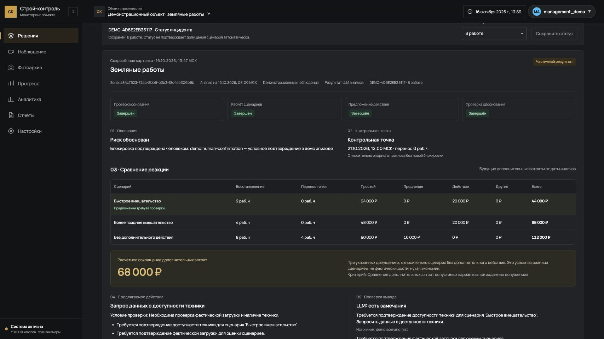

# Независимая критика после реализации

16 октября 2026. По просьбе пользователя выполнены две независимые проверки на **GPT-6.1 Sol, reasoning low** (запрошенный лёгкий режим). Критики не меняли файлы, не читали `.env` и не вызывали внешние LLM. После исправлений оба повторно проверили свои замечания.

Критик backend прочитал схемы, график/деньги, контекст источников, API, модели, worker, роли, guards и тесты; воспроизвёл дефекты чистыми локальными функциями. Критик продукта прочитал план, UI/API клиент, интеграцию App, роли/guards, отчёты и сохранённый LLM run; визуально посмотрел снимки deterministic UI. P0/P1 в новом проверенном пути они не установили. Это ограниченная проверка, не сертификат безопасности всей платформы.

## Найдено и исправлено

| Приоритет | Замечание | Исправление и доказательство |
|---|---|---|
| P2 | Рецензент мог вернуть `passed` при неполных деньгах, хотя весь run оставался partial | `validators.validate_review` запрещает passed при неполном/несогласованном калькуляторе. Добавлен `test_review_cannot_pass_incomplete_money_even_with_supported_evidence`; повторное воспроизведение критиком вернуло unsupported_pass |
| P2 | `intervene` допускалось для no_action либо без выбранного полного сценария | `validate_proposal` проверяет согласованность действия, выбранного сценария и полноты, также запрещает intervene при needs_review. Тест `test_intervention_requires_complete_chosen_action_scenario`; критик повторно получил action_scenario_mismatch/unsupported_intervention |
| P2 | После «Сохранить профиль» без нового расчёта reload подменял форму старым snapshot карточки | `ManagementPanel` сначала открывает актуальный профиль. Добавлены явные действия «Загрузить сохранённый профиль» / «Входы выбранной карточки». В IAB фактически: ставка 8000→9000, сохранить без расчёта, reload → форма 9000, старая карточка 44 000 ₽. Затем ставка возвращена на 8000 и профиль сохранён |
| P2 | Объект в разделе решений мог отличаться от глобальной шапки | `ManagementPanel` получает общий activeProjectId/onSelectProject из App; workspace по-прежнему keyed по projectId. В IAB: глобальный выбор B переключил шапку и раздел на B с пустой собственной историей; выбор A в разделе синхронно вернул шапку и историю A |

Оба критика подтвердили закрытие своих P2. Backend критик повторно проверил четыре описанных отрицательных случая и штатные guards всех четырёх демоэпизодов; новых регрессий в этом объёме не нашёл. Продуктовый критик подтвердил изменения статически; интегратор отдельно выполнил браузерные проверки выше.

После исправлений: **168 passed, 0 skipped**, 3.64 с, включая конкурентные тесты PostgreSQL; Ruff, frontend build/lint прошли. Один промежуточный тест ничьей потребовал согласовать `observe` для no_action с новым guard; итоговый тест проверяет допустимые равные минимумы с корректным типом действия. Денежные и ссылочные ограничения не ослаблялись.

Для проверки объектов создан только локальный `MANAGEMENT-DEMO-B` (`2d790c19-cba5-4cae-a341-d298ebdc8a23`) в изолированной `management_demo`, без инцидентов и расчётов. Данные заказчика не затронуты.

## Что улучшить дальше

1. **P2: структурировать условие проверки реакции.** Сейчас guard требует непустой текст. В реальном LLM run он общий: «проверка фактической загрузки и наличие техники». Следующий шаг — обязательные поля свежести/валидности кадра, зоны, требуемого класса и человеческого подтверждения, а затем поручение с ответственным и сроком. Наличие машины не доказывает производительность.
2. **P2: проверять перенос всех новых ограничений аналитика действий в review.** Сейчас гарантированно сохраняются evidence.missing_inputs; required_human_inputs предложения всегда остаются в карточке, но рецензент может не перечислить их все у себя. Усилить guard с передачей proposal и учитывать замечания/неразрешённые условия без потери смысла.
3. **P1 перед регулярным использованием LLM: измерить устойчивость финальной конфигурации.** Три настоящие роли подтверждены одним baseline; разработческие неудачи и отрицательный эпизод сохранены. Нужна независимая серия четырёх эпизодов и экспертная оценка полезности. Единичный результат не доказывает преимущество мультиагентности или надёжность сервиса.
4. **P0 перед внешним размещением: закрыть старые CRUD/media и заменить default JWT secret.** Эти известные проблемы вне нового management пути остаются в [backlog](management-validation.md). Защита новых endpoints не устраняет возможность изменить исходные данные через старый API.

Поручения, реальный CV набор и общая сводка нескольких объектов остаются следующими приоритетами плана. Критики не требовали заменить ими основной результат и не признали условные 68 000 ₽ фактической экономией.

## Проверенная карточка

[Настоящий сохранённый LLM run](../data/demo_management/verified_llm_run.json): три completed/generation=llm, условный fast, review needs_revision, итог partial. Замечания рецензента не скрыты и не превращены в успешный допуск.

